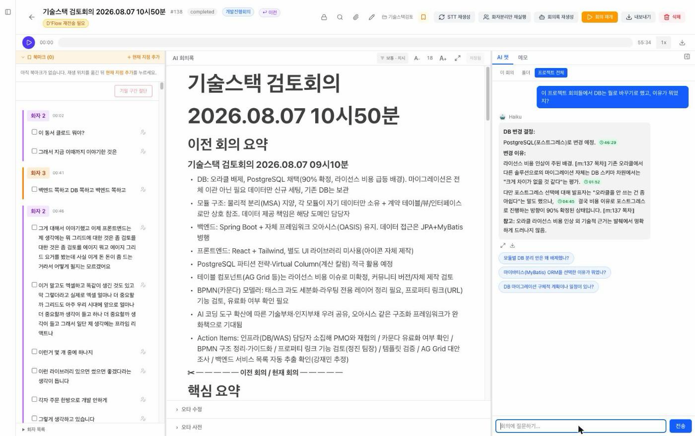

회의 AI 챗은 회의 전사와 회의록을 바탕으로 AI가 질문에 답하는 기능입니다. 「이 회의에서 결정된 일정이 뭐였지?」처럼 물어보면 회의 내용을 근거로 답해 줍니다.

## 챗 화면

회의 상세 화면(또는 라이브 화면) 오른쪽 패널의 「AI 챗」 탭이 챗입니다. 같은 패널에 「메모」 탭과, 오타 수정 도구가 있는 화면에서는 「오타수정」 탭이 함께 있습니다.

1. 범위 선택 줄: 「이 회의」, 「폴더」, 「프로젝트 전체」 세 단추입니다. 처음에는 「이 회의」가 선택되어 있습니다. 폴더나 프로젝트에 속하지 않은 회의에서는 해당 단추가 비활성화됩니다. 폴더·프로젝트 범위는 [폴더·프로젝트 챗](../folder-chat/)을 보세요.
2. 대화 영역: 질문과 답변이 순서대로 쌓입니다. 내 질문은 오른쪽 파란 말풍선, AI 답변은 왼쪽에 나타나며 답변 위에 답변한 모델 이름이 표시됩니다.
3. 입력칸: 「회의에 질문하기…」가 안내로 보입니다.
4. 「전송」 단추: 질문을 보냅니다.
5. 오른쪽 위 「패널 접기」 단추: 오른쪽 패널을 접습니다. 접힌 뒤에는 가장자리의 펼침 띠를 눌러 다시 엽니다.

아직 대화가 없으면 「이 회의 내용에 대해 무엇이든 물어보세요.」가 표시됩니다.

## 질문하는 방법

1. 입력칸에 질문을 적습니다.
2. 「전송」을 누르거나 Enter를 누릅니다. 한글 입력 중 글자를 확정하는 Enter는 전송되지 않으니 안심하고 쓰세요.
3. 답변이 만들어지는 동안 「…답변 작성 중」이 표시되고, 이어서 답변이 글자 단위로 나타납니다. 답변이 길면 화면이 자동으로 따라 내려가며, 위로 스크롤해 읽던 중이면 내려가지 않습니다.
4. 답변이 끝나면 다음에 물어볼 만한 질문이 작은 단추(제안 질문)로 최대 3개 나타납니다. 누르면 그 질문이 바로 전송됩니다. 답변이 진행 중일 때는 제안 단추가 비활성화됩니다.

답변에 실패하면 「답변 실패: 사유」가 붉은 글씨로 표시됩니다. 잠시 뒤 다시 질문해 보세요. 어떤 모델이 답하는지는 [「LLM」 탭](../../settings/llm/)에서 정한 설정을 따릅니다.

:::tip
질문을 구체적으로 할수록 답이 좋아집니다. 「일정이 어떻게 돼?」보다 「출시일과 담당자는 누구로 정해졌어?」처럼 물어보세요. 사람 이름이나 시점을 넣으면 근거도 더 정확해집니다.
:::

대화 내용은 서버에 저장됩니다. 다른 회의로 이동했다 돌아와도, 화면을 새로 열어도 이어서 볼 수 있습니다.

## 인용 근거로 해당 발언 듣기

AI가 회의 전사에서 근거를 가져온 문장에는 시계 아이콘과 시각이 적힌 작은 배지가 붙습니다. 이것이 인용 근거입니다.

1. 배지에 마우스를 올리면 「화자 이름 · 시각」이 표시됩니다.
2. 배지를 누르면 오디오가 그 시점으로 이동해 재생되고, 전사에서도 해당 발언이 강조됩니다.

답변이 맞는지 의심스러울 때는 반드시 인용 배지를 눌러 실제 발언을 들어 보세요. 근거 배지가 없는 문장은 AI가 일반적인 정리나 추론으로 쓴 부분일 수 있습니다.

배지 색은 화자마다 다릅니다. 오디오가 아직 준비되지 않은 회의에서는 배지가 흐리게 보이며 누를 수 없습니다.

## 답변 확대 보기

표나 다이어그램이 포함된 긴 답변은 좁은 패널에서 읽기 불편할 수 있습니다. 답변이 끝나면 말풍선 아래에 작은 아이콘 두 개가 나타납니다.

1. 「확대 보기」(네모 확대 아이콘)를 누릅니다.
2. 「AI 답변」 창이 크게 열립니다. 글자가 더 크게 보이고 표와 다이어그램도 넓게 표시됩니다.
3. 창 안에서도 인용 배지를 눌러 오디오를 이동할 수 있습니다.
4. 오른쪽 위 「닫기 ✕」 또는 창 바깥을 눌러 닫습니다.

## 답변을 MD 파일로 저장

답변을 문서로 남기고 싶을 때는 「MD 저장」을 씁니다. 말풍선 아래의 내려받기 아이콘(「MD 저장」)을 누르거나, 확대 보기 창 오른쪽 위의 「MD 저장」을 누릅니다.

- 저장하는 동안 「저장 중...」이 표시됩니다.
- 파일 이름은 `ai-answer-날짜-시각.md` 형식이고 마크다운 형식이며, 화면에 보이던 시각 배지 같은 인용 표시는 제거된 깔끔한 본문으로 저장됩니다.
- 데스크톱 앱에서는 저장 위치를 고르는 창이 열립니다. 웹에서는 브라우저의 내려받기로 저장됩니다.
- 실패하면 「저장에 실패했습니다. 다시 시도해 주세요.」가 표시됩니다.

:::note
MD 저장은 선택한 답변 하나만 저장합니다. 회의록 전체를 문서로 내보내려면 [내보내기](../../share/export/)를 쓰세요.
:::

## 쓸 수 있는 곳

- 회의 상세 화면: 완료된 회의를 보면서 질문합니다.
- 라이브 녹음 화면: 회의 중에도 오른쪽 패널에서 지금까지의 내용을 물어볼 수 있습니다. 자세한 내용은 [라이브 녹음 화면](../../recording/live/)을 보세요.

회의 여러 건을 가로질러 물어보려면 [폴더·프로젝트 챗](../folder-chat/)을 쓰세요. 단어를 직접 찾고 싶다면 [전역 검색](../search/)이 더 빠릅니다.
