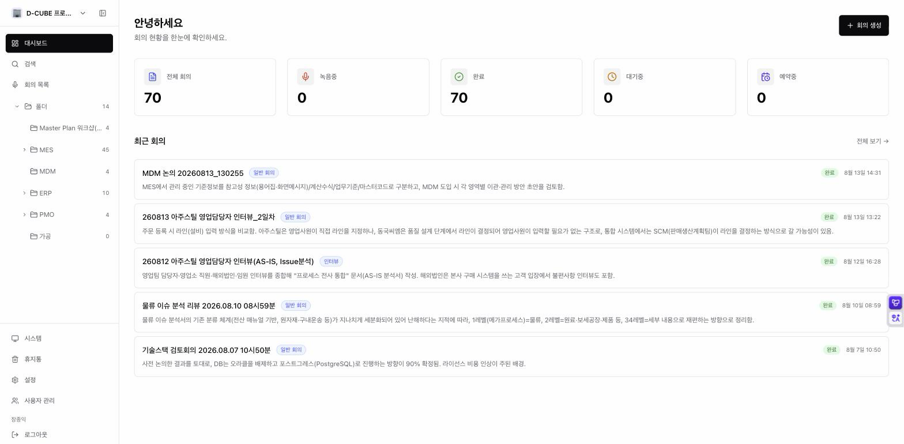

대시보드는 현재 프로젝트의 회의 현황을 한눈에 보여 주는 첫 화면입니다. 사이드바의 「대시보드」를 누르면 열립니다. 모바일에서는 하단 내비게이션의 「홈」이 같은 화면입니다.

## 화면 구성

1. 인사말과 「회의 생성」 단추: 맨 위에 「안녕하세요」와 「회의 현황을 한눈에 확인하세요.」가 보이고, 오른쪽에 「회의 생성」 단추가 있습니다.
2. 「놓친 예약 회의」 안내: 시간이 지나 시작하지 못한 예약 회의가 있을 때만 나옵니다.
3. 통계 카드: 회의 수를 상태별로 보여 줍니다.
4. 「예약된 회의」: 다가오는 예약이 있을 때만 나옵니다.
5. 「최근 회의」: 가장 최근에 만든 회의 5개와 「전체 보기 →」 링크가 있습니다.

대시보드의 숫자와 목록은 현재 프로젝트 기준입니다. 프로젝트를 바꾸면 그 프로젝트의 숫자로 바뀝니다. 또 중요 표시와 관계없이 프로젝트의 모든 회의를 세므로, 회의 목록 기본 화면보다 숫자가 클 수 있습니다.

## 통계 카드

카드를 누르면 회의 목록으로 이동하고, 상태 필터가 자동으로 적용됩니다.

| 카드 | 세는 회의 | 누르면 |
|---|---|---|
| 전체 회의 | 프로젝트의 모든 회의 | 회의 목록 전체 |
| 녹음중 | 지금 녹음하고 있는 회의 | 「녹음중」 필터가 적용된 목록 |
| 완료 | 끝난 회의 | 「완료」 필터가 적용된 목록 |
| 대기중 | 시작 전이고 예약이 없는 회의 | 「대기중」 필터가 적용된 목록 |
| 예약중 | 시작 시각이 정해진 예약 회의 | 「대기중」 필터가 적용된 목록 |
| 오프라인 회의 | 이 기기에 저장한 오프라인 회의 | 오프라인 회의 홈 |

「오프라인 회의」 카드는 Android 앱에서만 나옵니다. 오프라인 녹음은 [오프라인 녹음](../../recording/offline/)을 보세요.

:::note
예약 회의는 「대기중」에서 따로 떼어 「예약중」에 셉니다. 그래서 「대기중」과 「예약중」을 더해야 시작 전 회의의 총수가 됩니다.
:::

## 새 회의 만들기

화면 오른쪽 위의 「회의 생성」을 누르면 「새 회의 만들기」 창이 열립니다. 이 창에서 입력하는 항목은 [새 회의 만들기](../new-meeting/)에서 설명합니다.

대시보드에서 만든 회의는 폴더에 들어가지 않고 미분류로 생성됩니다. 즉시 시작하는 회의는 만들자마자 녹음 화면으로 이동합니다. 예약을 켠 회의는 녹음 화면으로 가지 않고 목록에 추가되며, 예약 시각이 되면 자동 또는 확인 후에 시작됩니다.

## 예약된 회의

예약해 둔 회의가 있으면 통계 카드 아래에 「예약된 회의」 구역이 나옵니다. 시작 시각이 가까운 순서로 정렬되며, 항목마다 다음이 보입니다.

- 회의 제목과 「예약중」 표시
- 시계 아이콘과 함께 「2026.11.18 09:00 · 자동 · 매주 월, 수」 같은 예약 시각과 시작 방식

항목을 누르면 그 회의의 상세 화면으로 이동합니다. 예약을 만들고 고치는 방법은 [회의 예약](../../schedule/schedule/)을 보세요.

## 놓친 예약 회의

앱이 꺼져 있었거나 자리를 비워서 예약 시각에 시작하지 못한 회의는 화면 위쪽에 노란 상자의 「놓친 예약 회의」로 모아 보여 줍니다. 항목마다 제목과 예약 시각, 두 개의 단추가 있습니다.

| 단추 | 하는 일 |
|---|---|
| 지금 시작 | 해당 회의의 녹음 화면으로 이동해 바로 녹음을 시작합니다. |
| 닫기 | 안내를 닫습니다. 같은 항목은 다시 나오지 않습니다. |

놓친 예약이 없으면 이 상자는 나타나지 않습니다.

## 최근 회의

「최근 회의」에는 가장 최근에 만든 회의가 최대 5개까지 나옵니다. 예약 회의는 위의 「예약된 회의」에서 보여 주므로 여기서는 빠집니다.

각 항목에는 다음이 보입니다.

- 제목과 회의 유형 배지(예: 「일반 회의」)
- 상태 배지(「녹음중」, 「완료」 등)와 만든 날짜·시각
- 한두 줄짜리 요약(있을 때만)

항목을 누르면 [회의 상세](../../minutes/meeting-detail/) 화면으로 이동합니다. 「전체 보기 →」를 누르면 [회의 목록](../list/)으로 갑니다.

회의가 하나도 없으면 「아직 회의가 없습니다.」와 「첫 회의 시작하기」 단추가 나옵니다. 이 단추는 회의 목록 화면으로 보냅니다.

:::tip
숫자가 기대와 다르면 먼저 사이드바 맨 위에서 어느 프로젝트를 보고 있는지 확인하세요. 대시보드는 현재 프로젝트의 회의만 셉니다.
:::
