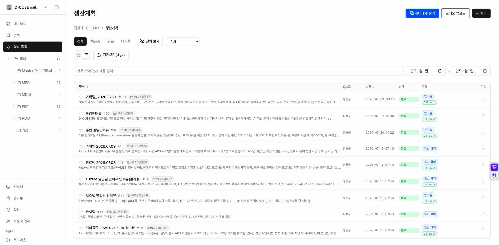

회의 목록은 현재 프로젝트의 회의를 모아 보고 찾고 정리하는 화면입니다. 사이드바의 「회의 목록」을 누르거나 폴더를 고르면 열립니다.

## 화면 구성

1. 제목 줄: 지금 보고 있는 범위의 이름이 크게 나옵니다. 모든 회의를 보고 있으면 「전체 회의」, 폴더에 넣지 않은 회의면 「폴더」, 특정 폴더면 그 폴더의 이름입니다. 오른쪽에 「폴더에게 묻기」, 「오디오 업로드」, 「새 회의」 단추가 있습니다.
2. 폴더 경로: 제목 아래에 「전체 회의 › 폴더 이름」 같은 경로가 나옵니다. 앞쪽 이름을 누르면 그 폴더로 올라갑니다. 자세한 내용은 [사이드바와 폴더](../../projects/sidebar-folders/)를 보세요.
3. 상태 탭과 「전체 보기」: 「전체」, 「녹음중」, 「완료」, 「대기중」 탭과 보기 범위를 바꾸는 「전체 보기」 단추, D'Flow를 쓰는 경우 전송 상태 상자가 있습니다.
4. 보기 방식 단추: 카드와 리스트 중에서 고릅니다. 옆에는 「가져오기(.tgz)」 단추가 있습니다.
5. 검색과 날짜 줄: 「제목·요약·전사 내용 검색」 칸, 시작일과 종료일, 「최근 3일」 단추가 있습니다.
6. 회의 목록 본문: 하위 폴더와 회의가 카드 또는 줄로 나옵니다.
7. 쪽 이동: 회의가 많으면 아래에 「이전」, 「다음」과 「1 / 5」 같은 쪽 번호가 나옵니다.

모바일에서는 화면이 좁아 일부가 다르게 보입니다. 제목 줄에 검색, 필터, 오디오 업로드 아이콘이 나오고, 상태·날짜 같은 조건은 「필터」 창에 모여 있으며, 새 회의는 오른쪽 아래의 둥근 「새 회의」 단추로 만듭니다.

## 기본으로 보이는 회의

처음 열었을 때 목록에는 다음 회의만 나옵니다.

- 중요 표시(별)를 단 회의
- 아직 끝나지 않은 회의(예약, 녹음 중, 대기)

중요 표시를 달지 않은 완료 회의는 숨겨집니다. 방금 만든 회의나 예약 회의가 기본 목록에서 사라지지 않게 하려는 규칙입니다. 숨겨진 회의까지 모두 보려면 「전체 보기」 단추를 켭니다.

| 단추 상태 | 보이는 회의 |
|---|---|
| 「전체 보기」 꺼짐(기본) | 중요 회의 + 끝나지 않은 회의 (마우스를 올리면 「전체 회의 보기」 안내) |
| 「전체 보기」 켜짐 | 모든 회의 (마우스를 올리면 「중요 회의만 보기」 안내) |

모바일의 「필터」 창에서는 같은 기능이 「표시 범위」 단추로 나오고, 「중요 회의만 표시」 또는 「전체 회의 표시 중」이라고 현재 상태를 알려 줍니다.

:::tip
찾는 회의가 목록에 없다면 먼저 「전체 보기」를 켜 보세요. 회의가 지워진 것이 아니라 중요 표시가 없는 완료 회의라서 숨겨진 경우가 많습니다. 폴더에 중요 표시를 달아 두면 그 폴더에서 새로 만든 회의가 처음부터 중요 회의가 됩니다.
:::

## 상태 탭

상태 탭을 누르면 해당 상태의 회의만 나옵니다. 대시보드 카드를 눌러 들어와도 같은 탭이 켜집니다.

| 탭 | 보이는 회의 |
|---|---|
| 전체 | 상태와 관계없이 모두 |
| 녹음중 | 녹음이 진행 중이거나 일시정지된 회의 |
| 완료 | 끝난 회의 |
| 대기중 | 아직 시작하지 않은 회의(예약 회의 포함) |

## 검색과 날짜 필터

필터를 바꾸면 잠시 뒤 목록이 자동으로 다시 불러와집니다. 단추를 따로 누를 필요가 없습니다.

### 검색

「제목·요약·전사 내용 검색」 칸에 단어를 입력하면 제목, 요약 미리보기, 전사 내용에서 해당 글자가 들어 있는 회의를 찾습니다. 검색어와 같은 글자는 카드에서 강조되어 보입니다. 프로젝트 전체를 가로질러 더 깊이 찾으려면 [전역 검색](../../ai/search/)을 쓰세요.

### 날짜

날짜 칸 두 개로 시작일과 종료일을 정해 기간 안에 만든 회의만 봅니다. 한쪽만 정해도 됩니다. 조건을 지우려면 「날짜 초기화」를 누릅니다.

### 「최근 3일」

「최근 3일」 단추는 오늘을 포함해 최근 3일 사이에 만든 회의만 빠르게 모아 봅니다. 켜진 동안은 단추가 강조색으로 바뀝니다. 다시 누르면 날짜 조건이 모두 풀립니다.

### D'Flow 전송 상태

D'Flow 연동을 켜 둔 경우에만 나오는 상자입니다. 선택지는 「전체」, 「D'Flow 전송됨」, 「재전송 필요」, 「미전송」입니다. 연동이 꺼져 있으면 이 상자 자체가 보이지 않습니다. 전송 방법은 [D'Flow 전송](../../share/dflow/)을 보세요.

### 조건 한꺼번에 지우기(모바일)

모바일 「필터」 창 맨 아래의 「초기화」를 누르면 상태, 날짜, D'Flow 조건이 모두 풀립니다.

## 보기 방식

보기 방식 단추의 안내 문구는 「카드 뷰」와 「리스트 뷰」입니다. 고른 방식은 기억해 두었다가 다음에 열 때도 그대로 보여 줍니다.

### 카드 보기

회의마다 카드가 하나씩 나옵니다. 카드에는 다음이 보입니다.

- 별 단추(중요 표시), 잠금 아이콘(잠긴 회의), 제목
- 상태 배지: 「녹음중」, 「일시정지」, 「변환중」, 「완료」, 「대기중」, 예약 회의는 「예약중」, 요약이 만들어지는 중이면 「요약중」이 더 붙습니다.
- 예약 회의라면 「2026.11.18 09:00 · 자동 · 매주 월」 같은 예약 시각과 방식
- 회의 번호 배지, 회의 유형 배지, 폴더 경로(폴더가 없으면 「미분류」), 태그
- D'Flow 배지: 전송했으면 「D'Flow ✓」, 전송 뒤 회의록이 고쳐졌으면 「D'Flow 재전송 필요」
- 「기밀 절단됨」 배지: 기밀 구간 절단이 적용된 회의입니다. 이 회의는 추가 녹음·전사를 받지 않습니다.
- 요약 미리보기, 만든 날짜, 만든 사람(남이 만든 회의는 「by 이름」)

하위 폴더가 있으면 회의 카드와 같은 격자에 폴더 카드가 먼저 나오고, 「회의 3개」, 「하위 폴더 2개」처럼 안에 든 양이 적혀 있습니다. 폴더 카드를 누르면 그 폴더로 들어갑니다.

### 리스트 보기

줄 단위로 촘촘하게 보여 줍니다. 열 이름은 「제목」, 「호스트」, 「날짜」, 「상태」, 「유형」, 「작업」입니다. 「제목」과 「날짜」 머리글을 누르면 그 기준으로 정렬되고, 다시 누르면 오름차순과 내림차순이 바뀝니다. 기본은 날짜 내림차순(최신 순)입니다.

## 회의 열기와 작업

회의 카드나 줄을 누르면 [회의 상세](../../minutes/meeting-detail/) 화면이 열립니다.

회의 오른쪽의 점 세 개 단추(「회의 메뉴」)에는 다음이 있습니다. 내가 고칠 수 있는 회의에서만 나옵니다.

| 메뉴 | 하는 일 |
|---|---|
| 정보 수정 | 제목, 요약, 회의 유형, 태그, 공유 범위 같은 정보를 고칩니다. |
| 폴더로 이동 | 다른 폴더나 「미분류」로 옮깁니다. |
| 프로젝트 이동 | 다른 프로젝트로 옮깁니다. |
| 회의 내보내기 | 회의를 파일로 내보냅니다. |
| 휴지통 | 회의를 휴지통으로 보냅니다. |

녹음 중인 회의에는 빨간 「종료」 단추가 함께 나와서 목록에서 바로 회의를 끝낼 수 있습니다.

「휴지통」을 누르면 「"회의 제목" 회의를 휴지통으로 이동합니다. 계속할까요?」라고 묻습니다. 복구하는 방법은 [휴지통](../../trash/trash/)을 보세요.

잠긴 회의는 별 단추가 눌러지지 않고 「잠긴 회의입니다」라고 안내합니다. 잠금은 [AI 회의록](../../minutes/ai-summary/)에서 다룹니다.

## 끌어서 정리하기

### 회의나 폴더를 폴더로 옮기기

카드나 줄을 마우스로 누른 채 끌어서 사이드바의 폴더 위에 놓으면 그 폴더로 이동합니다. 사이드바의 맨 위 「폴더」 줄에 놓으면 미분류가 됩니다. 폴더 카드도 같은 방식으로 다른 폴더 안에 넣을 수 있습니다. 자세한 규칙은 [사이드바와 폴더](../../projects/sidebar-folders/)를 보세요.

### 오디오 파일 끌어다 놓기

회의 목록 화면 어디에든 오디오 파일을 끌어다 놓으면 화면 전체에 놓는 자리 표시가 나타나고, 놓으면 「오디오 업로드」 창이 파일이 채워진 채로 열립니다. 여러 파일을 한꺼번에 놓아도 됩니다. 업로드 창의 사용법은 [오디오 업로드](../../recording/upload/)에 있습니다.

오디오가 아닌 파일만 놓으면 창이 열리지 않고 「오디오 파일만 업로드할 수 있습니다.」라는 안내가 잠깐 나옵니다.

:::note
회의 목록 화면의 끌어다 놓기는 오디오 파일 전용입니다. 문서나 링크 같은 첨부는 회의 상세 화면에서 추가합니다.
:::

## 폴더에게 묻기

「폴더에게 묻기」 단추를 누르면 지금 보고 있는 폴더(폴더를 고르지 않았다면 프로젝트 전체)의 회의를 바탕으로 AI에게 질문하는 서랍이 열립니다. 자세한 사용법은 [폴더·프로젝트 챗](../../ai/folder-chat/)을 보세요.

## 가져오기

회의 목록의 보기 방식 단추 옆의 「가져오기(.tgz)」 단추로 다른 곳에서 내보낸 회의·폴더 파일을 가져옵니다. 현재 프로젝트(폴더를 보고 있다면 그 폴더)로 들어옵니다. 자세한 내용은 [아카이브](../../share/archive/)를 보세요.
