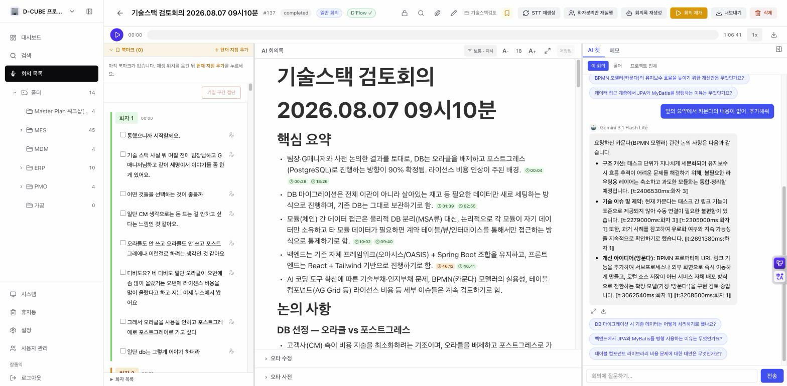
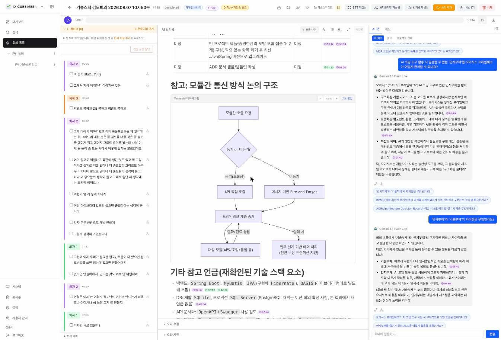

AI 회의록은 회의 전사를 바탕으로 AI가 정리한 문서입니다. 회의 중에는 실시간으로 갱신되고, 회의를 마치면 최종본이 만들어집니다. 이 문서는 사람이 직접 고칠 수도 있고, 요약 분량과 방식을 바꿔 다시 만들 수도 있습니다.

## AI 회의록 화면

회의 상세 화면에서 가운데에 있는 패널이 AI 회의록입니다. 화면 전체 구성은 [회의 상세 화면](../meeting-detail/)을 보세요.

패널 위쪽 줄에는 다음이 있습니다.

1. 제목 「AI 회의록」: 패널 이름입니다. 요약을 만드는 중에는 옆에 「요약 중...」 또는 「최종 요약 중...」 표시가 나타납니다.
2. 요약 옵션 단추: 「보통」, 「간결」처럼 현재 압축율이 적힌 작은 단추입니다. 누르면 분량과 추가 지시를 정하는 창이 열립니다. 회의 소유자(또는 관리자)에게만 보입니다.
3. 글자 크기 조절: 「A−」, 숫자, 「A+」 세 단추입니다. 회의록 본문 글자 크기를 바꿉니다. 가운데 숫자를 누르면 기본 크기로 돌아갑니다.
4. 「전체보기」 단추: 회의록을 떠 있는 큰 창으로 엽니다.
5. 저장 단추: 「저장」, 「저장됨」으로 바뀌며 수동 저장에 씁니다. 녹음 중에는 「자동 저장」 표시만 나옵니다.
6. 「더보기」(⋯) 단추: 「AI 원본과 비교」 메뉴가 있습니다. 회의를 고칠 수 있는 사람(소유자, 협업자, 관리자)에게만 보이고, 전체보기 창에는 나오지 않습니다. 아래 [AI 원본과 비교](#ai-원본과-비교)를 보세요.

요약 생성에 실패하면 패널 위쪽에 붉은 안내가 나옵니다. 회의 중에는 「요약 실패 — 다음 주기에 재시도합니다」가 보이며 다음 요약 주기에 자동으로 다시 시도합니다. 회의를 마친 뒤의 최종 요약이 실패하면 「최종 요약 실패: 사유」가 보입니다. 이때는 아래의 「회의록 재생성」을 눌러 다시 만드세요.

## 회의록 읽기

회의록은 제목, 목록, 표 등으로 구조화되어 있습니다. 회의 유형이나 설정한 템플릿에 따라 구성이 달라집니다.

### 인용 마커로 해당 시점 듣기

회의록 문장 끝에는 시계 아이콘과 시각이 적힌 작은 배지가 붙어 있습니다. 이것이 인용 마커이며, 그 문장이 전사의 어느 시점에서 나왔는지를 알려 줍니다.

1. 배지에 마우스를 올리면 「화자 이름 · 시각」이 표시됩니다.
2. 배지를 누르면 오디오가 그 시점으로 이동해 재생됩니다. 왼쪽 전사에서도 해당 발언이 강조됩니다.

배지 색은 화자별로 다릅니다. 화자 이름을 바꾸거나 화자분리를 다시 하면 배지의 색과 이름도 최신 화자 기준으로 갱신됩니다.

:::note
오디오가 준비되지 않은 회의에서는 배지가 흐리게 보이고 눌러도 이동하지 않습니다. [연결(이전) 회의](../linked-meetings/)에서 이어받은 내용의 마커는 지금 회의 오디오와 맞지 않으므로 눌러도 재생되지 않고, 마우스를 올리면 「이전 회의: 회의 제목 · 화자 · 시각」으로 출처만 알려 줍니다.
:::

### 표와 고압축 요약

회의록에는 표가 자주 쓰입니다. 압축율을 「아주 간결」이나 「간결」로 두어도 표와 차트는 유지되므로, 결정 사항이나 수치를 한눈에 보기 좋습니다. 표 안의 글자도 직접 고칠 수 있습니다.

### Mermaid 다이어그램

AI가 흐름도나 순서도가 어울린다고 판단하면 회의록에 다이어그램을 넣습니다.

- 다이어그램 위에서 「축소」, 「기본 보기 (100%)」, 「확대」로 크기를 조절합니다. 가로로 넘치면 좌우로 스크롤할 수 있습니다.
- 「코드 편집」을 누르면 다이어그램 원본 코드를 고칠 수 있고, 「적용」(또는 Cmd+Enter)으로 반영합니다. 「미리보기」로 되돌아옵니다.
- 코드에 오류가 있으면 「다이어그램 렌더 실패 — 코드를 수정하세요」와 함께 원본 코드가 나옵니다.

직접 넣고 싶다면 본문에서 `/`를 입력해 메뉴를 열고 「Mermaid 다이어그램」을 고르세요. 「다이어그램」, 「차트」로 검색해도 찾을 수 있습니다.

## 회의록 직접 고치기

회의록 본문을 누르면 바로 편집할 수 있습니다. 편집 권한은 회의 소유자와 [협업자](../../share/collaborators/)에게 있고, 잠긴 회의에서는 읽기 전용입니다.

- 글자를 고치면 약 2초 뒤 자동으로 저장됩니다. 바로 저장하려면 「저장」 단추를 누르세요. 저장이 끝나면 단추가 「저장됨」으로 바뀝니다.
- 본문에서 `/`를 입력하면 제목, 목록, 표 등 서식 메뉴가 열립니다.
- 직접 고친 내용은 서버에 저장되어 [내보내기](../../share/export/)에도 그대로 반영됩니다.

:::caution
「회의록 재생성」, 「STT 재생성」, 기밀 구간 절단을 하면 직접 고친 회의록은 사라집니다. 고친 내용을 남기고 싶다면 먼저 [내보내기](../../share/export/)로 저장해 두세요.
:::

### 오타 일괄 수정

회의록과 전사 양쪽에서 같은 오인식 단어를 한꺼번에 고치는 방법은 [전사 편집](../transcript/)의 「오타 수정」과 「오타 사전」을 보세요. 회의록 아래쪽에 접힌 형태로 있습니다.

## AI 원본과 비교

사람이 고친 회의록이 AI가 처음 만든 회의록과 어떻게 달라졌는지 줄 단위로 보여 줍니다.

1. 패널 위쪽의 「더보기」(⋯) 단추를 누르고 「AI 원본과 비교」를 고릅니다.
2. 「AI 원본과 비교」 창 위쪽에 「AI 생성」 시각과 「마지막 사람 수정」 시각이 나옵니다.
3. 그 아래에 차이가 표시됩니다. 지워진 줄은 붉은 취소선, 새로 쓴 줄은 초록색입니다. 바뀌지 않은 줄이 길게 이어지면 「… N줄 동일」로 접힙니다.

AI 원본이 없는 회의(이 기능이 생기기 전 회의, 또는 아직 녹음 중인 회의)에서는 「이 회의에는 AI 원본이 없습니다(기능 도입 전 회의 또는 녹음 중)」라고 나옵니다.

:::tip
이 차이는 관리자의 [STT 용어 학습](../../settings/stt-learning/)이 잘못 받아 적은 용어를 찾는 데에도 쓰입니다.
:::

## 회의록 재생성

회의가 끝난 뒤 설정을 바꿨거나 화자 이름을 정한 뒤에는 회의록을 처음부터 다시 만들 수 있습니다.

1. 회의 상세 화면 위쪽 단추 줄에서 「회의록 재생성」을 누릅니다. 창이 좁으면 로봇 아이콘만 보입니다.
2. 「기존 회의록을 삭제하고 전체 트랜스크립트를 바탕으로 처음부터 다시 생성합니다. 계속하시겠습니까?」 확인 창에서 「재생성」을 누릅니다.
3. 단추가 「재생성 중...」으로 바뀌고 회의록 칸이 비워집니다. 끝나면 새 회의록이 나타납니다.

전사가 한 건도 없으면 이 단추는 보이지 않습니다. 회의가 완료 상태일 때만 나타납니다.

:::tip
화자 이름을 먼저 지정하고 「회의록 재생성」을 누르면 회의록에 실제 이름이 들어갑니다. 화자가 둘 이상 나뉘었는데 회의록이 비어 있으면 「화자분리가 완료되었습니다. 좌측 화자 목록에서 이름을 지정한 뒤 회의록 재생성 버튼으로 회의록을 만들 수 있습니다.」라는 안내가 나옵니다. 자세한 내용은 [화자 분리와 이름 바꾸기](../speakers/)를 보세요.
:::

## 요약 옵션과 추가 지시

요약 옵션 단추(「보통」 등)를 누르면 「요약 옵션」 창이 열립니다. 여기서 정한 값은 회의 중 실시간 요약과 이후 재생성에 모두 적용됩니다.

### 회의록 압축율

다섯 단계 중 하나를 고릅니다. 고르는 즉시 저장됩니다.

| 단계 | 설명 |
|---|---|
| 아주 간결 | 결정·액션 위주, 표·차트는 유지 (가장 빠름) |
| 간결 | 항목당 1문장, 표·차트는 유지 |
| 보통 | 기본 분량 |
| 상세 | 맥락·근거 충실, 표 적극 활용 |
| 아주 상세 | 발언 흐름·반론까지 전부 (가장 느림) |

### 지속 재구조화

스위치 「지속 재구조화」로 요약 방식을 정합니다.

- 켬(기본): 매 요약마다 전체를 다시 정리합니다. 결정이 바뀌면 마지막 내용만 남습니다.
- 끔: 앞 내용은 그대로 두고 시간대별로 뒤에 덧붙입니다. 더 빠릅니다. 이 경우 요약 옵션 단추에 「· 증분」이 붙습니다.

### 요약 추가 지시

「요약 추가 지시」 칸에 AI에게 줄 주문을 최대 2000자까지 적을 수 있습니다. 예를 들면 다음과 같습니다.

- 수치는 표로 정리, 영어 용어 병기
- 결정 사항을 맨 위에 모아서 보여 주기

입력한 뒤 칸 밖을 누르거나 「저장」을 누르면 저장됩니다. 지시가 있으면 요약 옵션 단추에 「· 지시」가 붙습니다. 지시는 다음 요약부터 적용되므로, 이미 만들어진 회의록에 반영하려면 「회의록 재생성」을 누르세요.

저장에 실패하면 「저장 실패 — 네트워크 또는 권한을 확인하고 다시 시도하세요」가 나옵니다.

## 전체보기

회의록을 크게 읽고 싶을 때는 패널 위의 「전체보기」 단추를 누릅니다.

- 데스크톱에서는 화면 위에 떠 있는 창으로 열립니다. 제목 줄을 끌어 옮기고, 가장자리를 끌어 크기를 바꿀 수 있으며, 위치와 크기는 다음에도 기억됩니다. 뒤쪽의 전사를 그대로 읽고 클릭할 수 있습니다. 닫으려면 오른쪽 위 「닫기」(X)를 누르거나 Esc를 누르세요.
- 모바일에서는 화면 전체로 열리며 오른쪽 위 X로 닫습니다.
- 전체보기는 읽기 전용입니다. 글자 크기 조절은 이 창에서도 함께 쓸 수 있고, 설정은 본문 패널과 공유됩니다.

## 회의 잠금

회의를 잠그면 내용이 바뀌는 것을 막을 수 있습니다. 소유자와 관리자만 잠글 수 있습니다.

1. 회의 상세 화면 제목 오른쪽의 자물쇠 단추(「회의 잠금」)를 누릅니다.
2. 잠기면 제목 옆에 「읽기 전용」(모바일에서는 「잠금」) 배지가 나타납니다.
3. 풀려면 같은 위치의 「회의 잠금 해제」 단추를 누릅니다.

잠긴 회의에서는 회의록 편집, 「회의록 재생성」, 「STT 재생성」, 「화자분리만 재실행」, 「회의 재개」, 오타 수정, 전사 편집, 삭제 등 내용을 바꾸는 동작이 모두 비활성화되고, 단추에 올리면 「잠긴 회의입니다 — 잠금을 해제한 뒤 다시 시도하세요.」라고 알려 줍니다. 내보내기는 계속 쓸 수 있습니다.

## 회의 중 실시간 회의록

녹음하는 동안에도 AI 회의록은 일정한 주기로 자동 갱신됩니다. 이때는 편집 단추 자리에 「자동 저장」 표시가 나옵니다. 라이브 화면에 대해서는 [라이브 녹음 화면](../../recording/live/)을 보세요.
