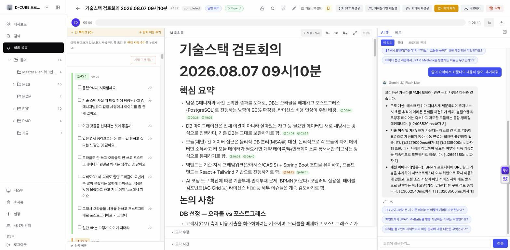

회의 상세 화면은 회의 목록이나 대시보드에서 회의를 눌렀을 때 열리는 화면입니다. 전사, AI 회의록, 메모, AI 챗, 녹음 오디오를 한 곳에서 보고 고칠 수 있습니다. 이 쪽에서는 화면의 각 부분이 무엇인지와 기본 사용법을 설명하고, 자세한 편집 방법은 해당 쪽으로 이어 드립니다.

## 화면 구성

데스크톱 화면은 위에서부터 다음 순서로 구성됩니다.

1. 상단 헤더: 목록으로 돌아가기, 제목, 상태 배지, 도구 아이콘, 액션 버튼이 한 줄(폭이 좁으면 여러 줄)로 놓입니다.
2. 페이지 내 검색 바: 검색 아이콘을 눌렀을 때만 나타납니다.
3. 오디오 플레이어: 녹음된 오디오가 있을 때 재생 막대가 나타납니다.
4. 첨부 영역: 「첨부 보기」를 눌렀을 때만 펼쳐집니다.
5. 본문 세 패널: 왼쪽 전사·화자, 가운데 AI 회의록, 오른쪽 AI 챗·메모. 패널 사이 경계선을 끌어 폭을 조절할 수 있습니다.

회의 정보를 불러오는 동안은 제목 자리에 「회의 미리보기」가 보이다가 곧 실제 제목으로 바뀝니다. 음성 파일을 올려 변환 중인 회의는 이 화면 대신 변환 진행 화면이 나타납니다. [오디오 파일 업로드](../../recording/upload/)를 보세요.

:::note
회의를 볼 권한이 없으면 「접근 권한이 없습니다」, 삭제되었거나 없는 회의면 「회의록을 찾을 수 없습니다」가 나옵니다. 권한은 [회의 협업자 권한](../../share/collaborators/)에서 설명합니다.
:::

## 상단 헤더

### 제목과 배지

- 제목: 편집 권한이 있고 잠겨 있지 않으면 제목에 마우스를 올렸을 때 「클릭하여 제목 편집」이 나옵니다. 눌러서 바로 고치고, Enter를 누르거나 다른 곳을 누르면 저장되고, Esc를 누르면 편집을 취소합니다.
- 회의 번호: 「#123」 형태의 배지입니다. 누르면 번호가 복사되며(「회의 ID 복사」) 잠깐 「복사됨」으로 바뀝니다.
- 「읽기 전용」: 회의가 잠겨 있을 때 나타납니다(모바일에서는 「잠금」).
- 상태 배지: 회의의 진행 상태를 보여 줍니다. 모바일에서는 「녹음」, 「완료」, 「대기」로 줄여 표시합니다.
- 「요약중」: AI 회의록을 만드는 중일 때 나타납니다(모바일에서는 「요약」). 마우스를 올리면 「요약 생성 중 — 완료까지 수십 초 걸릴 수 있습니다」라고 안내합니다. 새로고침해도 유지됩니다.
- 회의 유형 배지: 「팀 회의」처럼 유형 이름이 보입니다.
- 「↩ 이전」: 이전 회의를 연결해 둔 회의에만 나타납니다. [연결 회의](../linked-meetings/)에서 설명합니다.
- D'Flow 배지: 「D'Flow ✓」(전송됨) 또는 「D'Flow 재전송 필요」(전송 뒤 회의록이 수정됨). [D'Flow 전송](../../share/dflow/)을 보세요.
- 태그: 데스크톱에서는 회의에 단 태그가 색깔 배지로 보입니다. 태그는 [사이드바와 폴더](../../projects/sidebar-folders/)에서 설명합니다.

### 도구 아이콘

| 아이콘 | 마우스를 올렸을 때 | 하는 일 |
|---|---|---|
| 돋보기 | 「페이지 내 검색 (Ctrl+F)」 | 검색 바를 엽니다. |
| 클립 | 「첨부 보기」/「첨부 숨기기」 | 첨부 영역을 펼치거나 접습니다. |
| 연필 | 「회의 정보 수정」 | 회의 정보 수정 창을 엽니다. 잠긴 회의에서는 「잠긴 회의입니다」로 바뀌고 눌러지지 않습니다. |
| 책갈피 | 「북마크 보기」/「북마크 숨기기」 | 전사 위쪽의 북마크 목록을 켜고 끕니다. |
| 자물쇠 | 「회의 잠금 (읽기 전용)」/「회의 잠금 해제」 | 회의를 잠그거나 풉니다. 회의를 만든 사람과 관리자만 쓸 수 있습니다. |

제목 편집 중에는 폭을 확보하려고 돋보기·클립·연필·책갈피가 잠시 접힙니다.

데스크톱에서는 이 아이콘들 옆에 프로젝트와 폴더 경로(「프로젝트 › 폴더」)가 작게 보입니다. 마우스를 올리면 전체 경로가 나옵니다.

## 액션 버튼

헤더 오른쪽의 액션 버튼은 회의 상태에 따라 보이는 것이 달라집니다. 화면 폭이 1440px 이상일 때는 아이콘 옆에 이름이 함께 표시되고, 그보다 좁으면 아이콘만 보입니다(마우스를 올리면 이름이 나옵니다).

| 버튼 | 보이는 때 | 하는 일 |
|---|---|---|
| 회의 진행 | 대기 또는 녹음 중인 회의 | 라이브 녹음 화면으로 이동합니다. [라이브 녹음](../../recording/live/)을 보세요. |
| 회의 재개 | 완료된 회의 | 라이브 녹음 화면으로 돌아가 이어서 녹음합니다. |
| 회의록 재생성 | 완료된 회의이고 전사가 있을 때 | 기존 회의록을 지우고 전체 전사로 새로 만듭니다. 확인 창이 뜹니다. |
| STT 재생성 | 오디오가 있고 완료 또는 대기 상태 | 전사를 처음부터 다시 만듭니다. 확인 창이 뜹니다. |
| 화자분리만 재실행 | 오디오가 있고 완료된 회의 | 전사는 그대로 두고 화자만 다시 나눕니다. 약 1~2분 걸리며 화자 이름은 초기화됩니다. |
| 내보내기 | 항상 | 회의록을 파일로 내려받거나 화이트보드 등을 만듭니다. |
| 삭제 | 편집 권한이 있는 사용자(실제 삭제는 소유자·시스템 관리자만 가능) | 회의를 삭제합니다. 협업자가 누르면 서버가 거부합니다. |

:::caution
「삭제」는 확인 창 없이 바로 실행되고 대시보드로 돌아갑니다. 삭제된 회의는 휴지통으로 이동하므로 [휴지통](../../trash/trash/)에서 복구할 수 있습니다. 회의를 만든 사람과 관리자만 삭제할 수 있습니다.
:::

- 「STT 재생성」 확인 창은 「기존 트랜스크립트와 회의록이 모두 삭제되고, 저장된 오디오로 처음부터 다시 생성됩니다. 음성 인식이 끝나면 AI 회의록(요약)도 이어서 자동으로 생성합니다. 계속하시겠습니까?」라고 묻습니다.
- 「화자분리만 재실행」 확인 창은 「전사 텍스트는 그대로 두고, 현재 민감도 설정으로 화자만 다시 분리합니다. 화자 이름은 초기화됩니다. 다시 전사하지는 않으며 1~2분 정도 걸립니다. 계속하시겠습니까?」라고 묻습니다.
- 「회의록 재생성」 확인 창은 「기존 회의록을 삭제하고 전체 트랜스크립트를 바탕으로 처음부터 다시 생성합니다. 계속하시겠습니까?」라고 묻습니다.
- 편집 권한이 없는 사용자(만든 사람이나 협업자가 아닌 경우)에게는 회의를 바꾸는 버튼이 보이지 않고 「내보내기」만 남습니다.
- 회의가 잠겨 있으면 내용을 바꾸는 버튼이 모두 비활성이 되고, 마우스를 올리면 「잠긴 회의입니다 — 잠금을 해제한 뒤 다시 시도하세요.」가 나옵니다. 「내보내기」는 잠겨 있어도 쓸 수 있습니다.

「내보내기」 버튼을 누르면 「회의록 내보내기」 패널이 열립니다. 「파일」 줄에서 `.md`, `.pdf`, `.docx`를 고르고 「AI 생성」 줄에서 화이트보드 등을 만듭니다. 자세한 내용은 [회의록 내보내기](../../share/export/)를 보세요.

## 왼쪽 패널: 전사와 화자

왼쪽 패널은 위에서부터 다음 순서입니다.

1. 북마크 목록: 헤더의 책갈피 아이콘을 켜면 나타납니다. 「북마크 (3)」처럼 개수가 보이고, 항목을 누르면 그 시점으로 이동해 재생합니다.
2. 전사: 말한 순서대로 화자와 시간, 내용이 보입니다. 항목을 누르면 오디오가 그 시점으로 이동하고, 재생 중에는 지금 말하는 줄이 강조되며 자동으로 따라 내려갑니다.
3. 「화자 목록」: 화자를 확인하고 이름을 바꾸는 접이식 영역입니다.

전사에 글자를 고치거나, 한 발언을 둘로 나누거나, 기밀 구간을 잘라내는 방법은 [전사 편집](../transcript/)을, 화자 이름 바꾸기는 [화자 분리와 이름 바꾸기](../speakers/)를 보세요.

### 북마크 사용하기

- 「현재 지점 추가」: 지금 재생 중인 위치에 북마크를 추가합니다. 북마크가 없으면 「아직 북마크가 없습니다. 재생 위치를 옮긴 뒤 현재 지점 추가를 누르세요.」라고 안내합니다.
- 북마크 항목: 항목을 누르면 그 지점으로 이동합니다. 라벨을 고치는 「라벨 편집」(연필)과 「삭제」(휴지통) 단추가 있고, 라벨이 없으면 「(라벨 없음)」으로 보입니다.
- 목록 머리를 누르면 접거나 펼 수 있습니다.
- 녹음 중에 북마크를 만드는 방법은 [라이브 녹음](../../recording/live/)을 보세요.

## 가운데 패널: AI 회의록

가운데에는 AI가 정리한 회의록이 있습니다. 위쪽 줄에는 요약 옵션(압축율 등), 글자 크기 조절, 「전체보기」, 「저장」 단추가 있습니다. 직접 고친 내용은 잠시 뒤 자동으로 저장되며, 「저장」 단추로 바로 저장할 수도 있습니다. 저장할 변경이 없으면 「저장됨」으로 표시됩니다. 읽기, 편집, 다시 만들기, 다이어그램은 [AI 회의록](../ai-summary/)에서 설명합니다.

회의록 아래에는 오타수정과 오타사전 영역이 있습니다. 잠긴 회의이거나 편집 권한이 없으면 숨겨집니다.

회의록 안의 시간 배지(예: `12:34`)를 누르면 오디오가 그 발언 시점으로 이동합니다. 이전 회의에서 가져온 내용의 배지는 이동하지 않습니다. 이 점은 [연결 회의](../linked-meetings/)에서 설명합니다.

## 오른쪽 패널: AI 챗과 메모

- 「AI 챗」: 이 회의 내용에 대해 질문합니다. 범위 단추 「이 회의」, 「폴더」, 「프로젝트 전체」로 질문 범위를 넓힐 수 있습니다. 답변 안의 근거를 누르면 해당 시점으로 이동합니다. [회의 AI 챗](../../ai/chat/)을 보세요.
- 「메모」: AI 회의록과 별개로 직접 적는 메모입니다. 「저장」을 눌러 저장하며 「저장 중...」이 표시됩니다.
- 오른쪽 위 「패널 접기」를 누르면 오른쪽 패널이 접히고 폭이 가운데 회의록에 더해집니다. 접힌 뒤에는 화면 오른쪽 끝의 펼침 띠를 눌러 다시 엽니다.

## 오디오 플레이어

녹음된 오디오가 있는 회의는 헤더 아래에 재생 막대가 나타납니다. 오디오를 불러오는 동안은 「오디오 불러오는 중...」, 막대 끝에 「로딩...」이 보입니다.

| 부분 | 설명 |
|---|---|
| 재생/일시정지 | 재생을 시작하거나 멈춥니다. |
| 현재 시간 / 전체 시간 | 재생 위치와 전체 길이를 보입니다. |
| 진행 막대 | 눌러서 원하는 지점으로 이동합니다. |
| 배속 단추 | 누를 때마다 0.5x, 0.75x, 1x, 1.25x, 1.5x, 2x 순으로 바뀝니다. |
| 다운로드 | 「다운로드」 아이콘으로 오디오 파일을 내려받습니다. |

전사 줄, 북마크, 회의록의 시간 배지, AI 챗의 근거를 누르면 플레이어가 그 지점으로 이동해 곧바로 재생합니다.

## 페이지 내 검색

헤더의 돋보기 아이콘을 누르거나 `Ctrl+F`(macOS는 `Cmd+F`)를 누르면 검색 바가 열립니다.

1. 입력 칸 「전사·요약 검색」에 찾을 말을 입력합니다.
2. 전사와 AI 회의록에서 일치하는 곳이 강조되고, 개수와 현재 위치가 표시됩니다.
3. 「다음 매치」, 「이전 매치」로 이동합니다.
4. 「검색 닫기」를 누르면 닫힙니다.

검색 중에는 전사가 자동으로 내려가지 않아 찾은 위치를 놓치지 않습니다. 여러 회의를 한꺼번에 찾으려면 [전역 검색](../../ai/search/)을 쓰세요.

## 첨부 영역

헤더의 클립 아이콘을 누르면 안건, 참고자료, 이해관계자, 명함 분류의 첨부를 보고 추가할 수 있습니다. 「파일 추가」와 「링크 추가」 단추가 있고, 잠긴 회의에서는 「잠긴 회의입니다」라고 안내하며 눌러지지 않습니다. 사용법은 [라이브 녹음](../../recording/live/)의 첨부 설명과 같습니다.

회의 상세 화면에 파일을 끌어 놓으면 오디오 파일은 이 회의에 붙일지 새 회의로 만들지 묻고, 그 밖의 파일은 첨부로 분류해 등록합니다. [오디오 파일 업로드](../../recording/upload/)를 보세요.

## 회의 정보 수정

연필 아이콘으로 열리는 창에서 제목, 회의 유형, 참석자, 이전 회의 연결 등을 고칩니다. 저장하면 헤더의 배지에 바로 반영됩니다.

## 모바일에서의 구성

화면이 좁으면 구성이 다음처럼 바뀝니다.

- 헤더가 두 줄이 됩니다. 첫 줄은 뒤로 가기, 제목, 돋보기·클립·연필·자물쇠 아이콘이고, 둘째 줄은 옆으로 밀 수 있는 배지 줄과 액션 버튼입니다.
- 본문은 아래쪽 탭 「기록」, 「요약」, 「AI 챗」, 「메모」로 나뉩니다. 「기록」 탭에서는 「화자」를 펼쳐 화자 목록을 봅니다.
- 오디오는 화면 아래에 작은 미니 플레이어로 고정되고, 누르면 큰 플레이어가 아래에서 올라옵니다.

## 잠긴 회의

회의를 만든 사람이나 관리자가 자물쇠 아이콘을 누르면 회의가 잠기고 읽기 전용이 됩니다. 잠긴 회의에서는 제목, 전사, 회의록, 메모, 화자 이름, 북마크, 첨부를 고칠 수 없고 재생성·삭제 같은 버튼도 비활성이 됩니다. 실수로 내용을 바꾸는 일을 막고 싶을 때 씁니다. 다시 풀려면 같은 아이콘(「회의 잠금 해제」)을 누릅니다. 권한이 없어 바꾸지 못하면 「잠금 상태 변경에 실패했습니다. 권한을 확인하세요.」가 나옵니다.

## 화면에서 가능한 일 정리

| 하고 싶은 일 | 어디서 | 안내 |
|---|---|---|
| 회의록 읽고 고치기 | 가운데 패널 | [AI 회의록](../ai-summary/) |
| 전사의 오타 고치기 | 왼쪽 패널 | [전사 편집](../transcript/) |
| 화자 이름 바꾸기 | 왼쪽 「화자 목록」 | [화자 분리와 이름 바꾸기](../speakers/) |
| 이전 회의와 이어 쓰기 | 연필 아이콘 | [연결 회의](../linked-meetings/) |
| 회의에 대해 묻기 | 오른쪽 「AI 챗」 | [회의 AI 챗](../../ai/chat/) |
| 파일로 내보내기 | 「내보내기」 | [회의록 내보내기](../../share/export/) |
| 다른 사람과 함께 보기 | 다른 기기에서 실시간으로 보기 | [다른 기기에서 실시간으로 보기](../../share/live-share/) |
