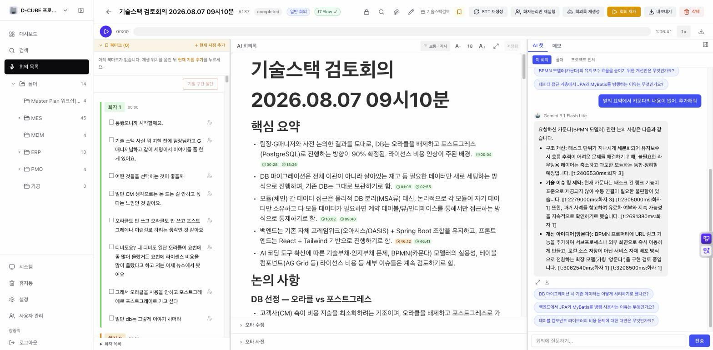

화자 분리는 누가 말했는지를 구분해 전사에 표시하는 기능입니다. 회의록의 인용 배지 색과 화자별 발언 묶음도 이 정보를 바탕으로 합니다.

## 화자 분리가 적용되는 시점

화자 분리는 설정에 따라 켜고 끌 수 있고, 적용되는 시점이 정해져 있습니다.

| 상황 | 화자 구분 |
|---|---|
| 실시간 녹음 중 | 화자 라벨이 붙지 않습니다. 녹음이 끝난 뒤 STT 재생성으로 적용할 수 있습니다 |
| 오디오 파일 업로드 | 업로드 후 처리 과정에서 적용됩니다 |
| 「STT 재생성」 | 전사를 새로 하면서 적용됩니다 |
| 「화자분리만 재실행」 | 전사는 두고 화자만 다시 나눕니다 |
| 오프라인(온디바이스) 녹음 | 화자 분리를 지원하지 않습니다 |

화자 분리를 쓰려면 설정이 켜져 있어야 합니다. 「설정」의 「음성·인식」 탭(관리자와 로컬 모드에서만 보입니다)에 있는 「화자 분리 설정」에서 「화자 분리 사용」을 켜고, 필요하면 「화자 구분 민감도」를 조절합니다. 자세한 내용은 [「음성·인식」 탭](../../settings/voice/)을 보세요. 꺼져 있으면 모든 발화가 하나의 화자로 기록됩니다.

:::tip
여러 명이 한 화자로 뭉쳐 나온다면 「화자 구분 민감도」 값을 낮추세요. 낮을수록 화자를 더 많이 나눕니다. 이 값은 파일 업로드, STT 재생성, 「화자분리만 재실행」을 할 때 적용됩니다.
:::

## 화자 목록

회의 상세 화면 왼쪽 전사 패널 아래에 「화자 목록」이 있습니다. 화자가 감지되면 자동으로 펼쳐지고, 제목 옆에 화자 수가 표시됩니다(예: 「화자 목록 (3)」). 같은 이름으로 정한 화자는 1명으로 셉니다.

각 줄은 다음으로 이루어져 있습니다.

1. 화자 ID 배지(예: `SPEAKER_00`): 화자마다 색이 다릅니다. 배지를 누르면 「이 화자 발화로 이동」하여 그 화자의 다음 발언 위치로 오디오가 이동합니다. 계속 누르면 그 화자의 발언을 차례로 건너뜁니다.
2. 이름: 아직 지정하지 않았으면 「이름 없음」으로 표시됩니다. 누르면 이름을 편집합니다.
3. 맨 위 오른쪽 「초기화」 단추: 화자 정보를 지웁니다.

감지된 화자가 없으면 「감지된 화자 없음」이, 녹음 중이면 「화자 감지 대기 중...」이 표시됩니다.

## 화자 이름 바꾸기

기본 이름은 `SPEAKER_00`처럼 구분용 ID입니다. 실제 이름으로 바꿔 두면 전사, 회의록, 내보내기 문서에 모두 그 이름이 나옵니다.

### 화자 목록에서

1. 이름 부분(「이름 없음」 또는 현재 이름)을 누릅니다. 마우스를 올리면 「클릭하여 이름 편집」이라고 안내됩니다.
2. 새 이름을 입력하고 Enter를 누릅니다. Esc를 누르면 취소됩니다.

### 전사에서 바로

전사 패널의 화자 이름을 더블클릭해도 같은 방법으로 이름을 고칠 수 있습니다(「더블클릭하여 이름 편집」). 같은 ID의 모든 발언에 한꺼번에 반영됩니다.

이름을 바꾼 뒤에는 이미 만들어진 AI 회의록의 인용 배지 이름과 색이 최신 화자 기준으로 바뀝니다. 회의록 본문에 적힌 화자 이름까지 새 이름으로 쓰고 싶다면 [회의록을 재생성](../ai-summary/)하세요.

:::note
특정 발언 하나의 화자만 잘못되었다면 이름 바꾸기가 아니라 [화자변경/발언분할](../transcript/)을 쓰세요. 이름 바꾸기는 해당 ID 전체에 적용됩니다.
:::

## 화자분리만 재실행

화자 구분이 마음에 들지 않을 때, 음성을 다시 인식하지 않고 화자만 다시 나눌 수 있습니다. 전사 문장은 그대로 유지됩니다.

1. 필요하면 먼저 「음성·인식」 탭에서 「화자 구분 민감도」를 조절합니다. 이 탭은 관리자만 볼 수 있으니, 일반 사용자는 관리자에게 조절을 요청하세요.
2. 회의 상세 화면 위쪽 단추 줄에서 「화자분리만 재실행」을 누릅니다. 오디오 파일이 저장된 완료 상태 회의에서만 보입니다.
3. 확인 창에서 내용을 읽고 「재실행」을 누릅니다. 1~2분 정도 걸리며 진행률이 표시됩니다.

:::caution
재실행하면 화자 이름이 초기화됩니다. 끝난 뒤 화자 목록에서 이름을 다시 지정하고, 필요하면 「회의록 재생성」을 누르세요. 전사를 직접 고친 내용은 유지됩니다.
:::

## 화자 정보 초기화

화자 목록의 「초기화」는 화자 DB를 비웁니다. 누르면 「화자 DB를 초기화하면 화자 구분이 처음부터 다시 시작됩니다. 계속할까요?」라고 확인합니다. 잠긴 회의에서는 쓸 수 없습니다(「잠긴 회의입니다」). 화자 이름이 모두 사라지므로 신중하게 쓰세요.

## 참석자(명함) 확인

화자 이름과는 별개로, 회의에 첨부한 명함 이미지를 인식해 참석자 정보를 모아 볼 수 있습니다. 첨부 영역에서 파일 종류를 「명함」으로 분류해 올리면 이름·소속 등이 인식되어 「참석자 (명함)」 목록에 카드로 나타나고, 사람 수가 함께 표시됩니다. 인식에 실패하면 「명함 인식에 실패했어요. 원본 이미지는 첨부에 남아 있습니다.」가 나오며 원본은 첨부 파일로 남습니다. 명함 카드는 화자 ID와 자동으로 연결되지 않으며, 화자 이름은 위 방법으로 직접 지정합니다.
