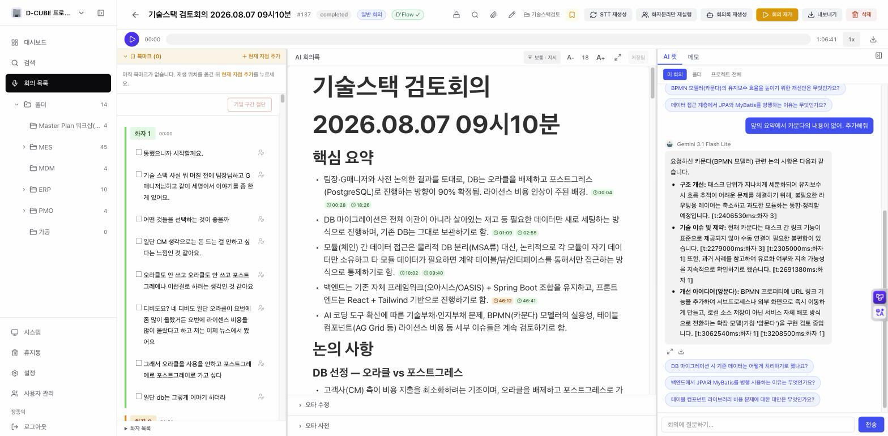

전사는 음성을 글자로 옮긴 기록입니다. 음성 인식은 완벽하지 않으므로 고유명사나 전문 용어가 잘못 적히기도 합니다. 이 문서에서는 전사를 바로잡는 여러 방법을 설명합니다.

## 전사 패널 화면

회의 상세 화면에서 왼쪽에 있는 패널이 전사입니다. 전체 화면 구성은 [회의 상세 화면](../meeting-detail/)을 보세요.

1. 화자 묶음: 같은 화자의 연속된 발언은 하나로 묶여 보입니다. 묶음 왼쪽에는 화자별 색 띠가 있고, 위쪽에 화자 이름과 시작 시각(`mm:ss`)이 나옵니다.
2. 발언 한 줄: 한 건의 전사 문장입니다. 줄을 누르면 오디오가 그 위치로 이동합니다. 재생 중인 발언은 파란 띠와 강조색으로 표시되며 자동으로 따라 스크롤됩니다.
3. 오른쪽 사람 아이콘: 「화자변경/발언분할」 단추입니다.
4. 화자 이름: 더블클릭하면 이름을 바로 고칠 수 있습니다. 자세한 내용은 [화자 분리와 이름 바꾸기](../speakers/)를 보세요.

전사가 아직 없으면 「트랜스크립트가 없습니다.」라고 표시됩니다.

:::note
회의가 잠겨 있거나 편집 권한이 없는 사용자에게는 편집 관련 단추가 보이지 않고, 전사는 읽기 전용입니다.
:::

## 문장 직접 고치기

1. 고칠 문장을 더블클릭합니다. 키보드로는 문장에 포커스를 두고 Enter를 누르면 됩니다. 문장 전체가 선택된 편집 상태가 됩니다.
2. 내용을 고칩니다.
3. Enter를 누르거나 다른 곳을 눌러 저장합니다. 취소하려면 Esc를 누릅니다.

고친 내용은 즉시 화면에 반영되고, 저장에 실패하면 원래 문장으로 되돌아갑니다. 줄바꿈이 필요하면 Shift+Enter를 씁니다. 한 문장은 최대 5000자이며, 내용을 모두 지우면 저장되지 않고 원래대로 돌아갑니다. 붙여넣기는 서식 없이 글자만 들어갑니다.

:::tip
문장을 고쳐도 이미 만들어진 AI 회의록은 자동으로 바뀌지 않습니다. 회의록까지 반영하려면 아래의 「오타 수정」을 쓰거나 [회의록을 재생성](../ai-summary/)하세요.
:::

## 오타 수정과 오타 사전

같은 오인식이 여러 군데 있을 때는 한 번에 바꾸는 편이 빠릅니다. 이 도구들은 AI 회의록 패널 아래(모바일에서는 요약 탭의 한 줄 막대)에 있고, 회의 소유자와 협업자만 쓸 수 있으며 잠긴 회의에서는 숨겨집니다.

### 오타 수정: 지금 회의에 한 번 적용

「오타 수정」 줄을 펼치면 안내문 「잘못된 용어를 올바른 용어로 일괄 치환합니다 (회의록 + 트랜스크립트)」가 나옵니다.

1. 「잘못된 용어」 칸에 틀리게 인식된 표기를, 「올바른 용어」 칸에 맞는 표기를 입력합니다.
2. 더 바꿀 단어가 있으면 「+ 용어 추가」를 눌러 줄을 늘립니다. 줄 끝의 ×는 그 줄을 지웁니다.
3. 「오타 수정 적용」을 누릅니다. 반영하는 동안 「반영 중...」이 표시됩니다.

회의록과 전사 양쪽에서 해당 표기가 한꺼번에 바뀝니다. 이 방식은 지금 회의에만 적용되고 사전에 남지 않습니다.

### 오타 사전: 앞으로도 계속 적용

자주 틀리는 용어는 「오타 사전」에 등록해 두세요. 사전은 세 단계로 나뉘어 표시됩니다.

| 단계 | 적용 범위 |
|---|---|
| 상위 폴더 | 그 폴더 아래 모든 회의 |
| 현재 폴더 | 이 폴더 아래 모든 회의. 「이 폴더의 사전은 하위 모든 회의에 영향을 줍니다.」 안내가 붙습니다 |
| 현재 회의 | 이 회의만 |

등록 방법은 다음과 같습니다.

1. 원하는 단계의 표 아래 줄에서 「잘못된 용어」, 「올바른 용어」를 입력합니다.
2. 방식을 고릅니다. 「리터럴」은 글자 그대로 바꾸고, 「정규식」은 패턴으로 바꿉니다. 일반 사용자는 「리터럴」이면 충분합니다.
3. 「추가」를 누릅니다. 정규식이 잘못되었으면 「추가 실패 (정규식이 올바른지 확인하세요)」가 나옵니다.

등록된 항목 옆에서 쓸 수 있는 동작은 다음과 같습니다.

- 「사용」 체크: 이 항목을 쓸지 끌지 정합니다.
- 「적용」: 이 항목만 지금 회의에 적용합니다.
- ×: 항목을 삭제합니다.
- 「사전 재적용」: 사전 전체를 지금 회의에 다시 적용합니다. 끝나면 「적용 완료 (트랜스크립트 N건 수정)」가 표시됩니다.

:::tip
폴더 사전에 한 번 등록해 두면 같은 폴더의 이후 회의에서도 같은 오인식이 자동으로 고쳐집니다. 사람 이름이나 제품명처럼 반복되는 용어에 특히 유용합니다.
:::

## 화자변경과 발언분할

한 줄의 화자가 잘못되었거나, 한 줄 안에 두 사람의 말이 섞여 있을 때 씁니다.

발언 줄 오른쪽의 사람 아이콘(「화자변경/발언분할」)을 누르면 같은 이름의 창이 열립니다. 위쪽에 「화자만 변경」과 「발언 분할」 두 탭이 있고, 처음에는 「화자만 변경」이 선택됩니다.

### 화자만 변경

1. 「화자」 목록에서 이 발언의 화자를 고릅니다. 목록에 없는 사람이면 「+ 새 화자 직접 입력」을 고르고 화자 ID를 적습니다.
2. 필요하면 「표시 이름 (선택)」에 이름을 입력합니다.
3. 「변경 저장」을 누릅니다.

텍스트는 그대로 두고 이 줄의 화자만 바뀝니다.

### 발언 분할

한 줄에 섞인 두 사람의 발언을 둘로 나눕니다.

1. 「발언 분할」 탭을 선택합니다.
2. 「텍스트 분할 지점」에서 단어와 단어 사이의 세로 막대를 눌러 나눌 위치를 고릅니다. 고른 막대는 파랗게 표시됩니다.
3. 「오디오 분할 위치」에 나눌 시각을 정합니다. 오디오를 해당 위치까지 재생해 둔 뒤 「현재 재생 위치 사용」을 누르거나, `mm:ss.mmm` 형식으로 직접 입력합니다. 시각은 그 발언의 시작과 끝 사이여야 하며, 벗어나면 허용 범위가 붉은 글씨로 안내됩니다.
4. 「첫 번째 조각 화자」와 「두 번째 조각 화자」를 각각 고릅니다.
5. 「미리보기」에서 두 조각의 시간 범위와 내용을 확인하고 「분할 저장」을 누릅니다.

:::tip
분할 시각을 정확히 잡으려면 먼저 오디오를 재생해 두 사람이 바뀌는 순간에 멈춘 뒤 「화자변경/발언분할」을 열고 「현재 재생 위치 사용」을 누르세요.
:::

다른 사람이 같은 발언을 먼저 고친 경우 「다른 곳에서 이 발언이 수정되었습니다. 다시 시도하세요.」가 나옵니다. 최신 내용으로 갱신되니 다시 지점을 고르면 됩니다.

## 기밀 구간 절단

회의 중 공유하면 안 되는 이야기가 나왔을 때, 해당 구간을 전사와 오디오에서 완전히 지울 수 있습니다. 회의 소유자(또는 관리자)에게만 보이고 잠긴 회의에서는 쓸 수 없습니다.

1. 전사 패널 위쪽에 「기밀 구간 절단」 단추가 나타나고, 각 발언 줄 왼쪽에는 체크 상자가 생깁니다.
2. 지울 발언들의 체크 상자를 선택합니다. 선택 개수가 「N개 선택」으로 표시됩니다.
3. 「기밀 구간 절단」을 누르면 확인 창이 열려 지워질 구간과 총 길이를 보여 줍니다.
4. 내용을 확인하고 계속하면 선택한 구간이 전사와 오디오에서 파기됩니다. 진행 중에는 「절단 중...」이 표시됩니다.

:::caution
되돌릴 수 없습니다. 확인 창에서 다음을 반드시 읽어 보세요.

- 오디오도 함께 잘리며, 재인코딩으로 약간의 음질 손실이 있습니다.
- AI 회의록이 삭제됩니다. 직접 고친 회의록도 함께 사라지고 복구되지 않으므로, 절단 후 필요하면 다시 생성해야 합니다.
- 이 회의를 이전 회의로 이어받은 다른 회의의 회의록에는 절단 전 내용이 이미 복사되어 남아 있을 수 있습니다.
- 이미 D'Flow로 전송한 회의록은 그대로 남습니다. D'Flow에서 직접 처리해야 합니다.
- 내 AI 챗 대화 기록에 인용된 내용은 남습니다.
:::

다른 사람이 동시에 같은 구간을 고치고 있거나 처리가 진행 중이면 서버가 안내 문구와 함께 절단을 거절하고 아무것도 지우지 않습니다.

## STT 재생성

저장된 오디오로 음성 인식을 처음부터 다시 돌립니다. 인식 결과가 크게 어긋났을 때, 음성 인식 설정을 바꿨을 때, 녹음 후 화자 분리를 적용하고 싶을 때 씁니다.

1. 회의 상세 화면 위쪽 단추 줄에서 「STT 재생성」을 누릅니다. 오디오 파일이 저장된 완료(또는 대기) 상태 회의에만 보입니다.
2. 확인 창 「STT 재생성」에서 내용을 읽고 「재생성」을 누릅니다.
3. 진행률 화면이 나타나고, 음성 인식이 끝나면 AI 회의록(요약)까지 자동으로 이어서 만들어집니다. 화자분리를 켜 둔 경우에도 회의록까지 자동 생성됩니다.

:::caution
기존 전사와 회의록이 모두 삭제되고 새로 만들어집니다. 직접 고친 문장, 오타 수정, 화자 이름도 초기화됩니다. 필요한 내용은 먼저 [내보내기](../../share/export/)로 저장해 두세요.
:::

전사를 다시 하지 않고 화자만 다시 나누려면 「화자분리만 재실행」이 더 빠릅니다. 자세한 내용은 [화자 분리와 이름 바꾸기](../speakers/)를 보세요. 음성 인식 모델과 관련된 설정은 [「음성·인식」 탭](../../settings/voice/)에 있습니다.
