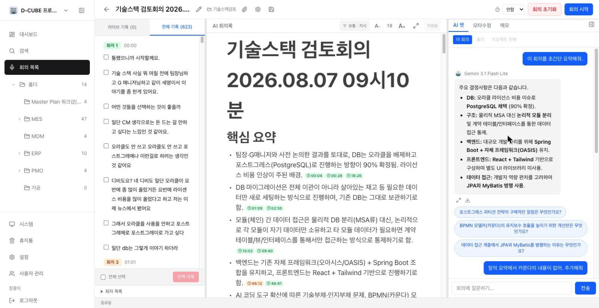

라이브 녹음 화면은 회의를 진행하는 동안 쓰는 화면입니다. 말하는 내용이 곧바로 자막으로 쌓이고, AI 회의록이 일정한 주기마다 자동으로 갱신됩니다. 이 쪽에서는 화면 구성, 녹음을 시작하고 끝내는 방법, 녹음 중에 쓸 수 있는 메모·북마크·첨부를 설명합니다.

## 라이브 녹음 화면에 들어가는 방법

- 새 회의를 만들면 곧바로 라이브 녹음 화면으로 이동합니다. 새 회의 만들기는 [새 회의 만들기](../../meetings/new-meeting/)를 보세요.
- 이미 만든 회의는 회의 상세 화면 위쪽의 「회의 진행」 버튼으로 들어갑니다. 아직 녹음하지 않은 회의(대기)나 녹음이 진행 중인 회의에 보이는 버튼입니다.
- 끝낸 회의에 내용을 더 이어서 녹음하려면 상세 화면의 「회의 재개」 버튼을 누릅니다.
- 예약해 둔 회의는 정해진 시각이 되면 이 화면이 열리면서 저절로 시작됩니다. 이때 아래쪽에 「회의를 시작합니다」 알림이 잠깐 나타납니다. 예약은 [회의 예약](../../schedule/schedule/)을 보세요.

:::note
회의를 시작하거나 초기화하는 단추는 회의를 만든 사람과 관리자에게만 보입니다. 협업자는 화면을 볼 수 있지만 녹음을 시작할 수는 없습니다. 권한은 [회의 협업자 권한](../../share/collaborators/)에서 설명합니다.
:::

## 화면 구성

데스크톱에서는 위쪽 컨트롤 바와 세 개의 영역으로 나뉩니다. 영역 사이의 경계선을 끌어 폭을 조절할 수 있습니다.

1. 컨트롤 바: 맨 위의 막대입니다. 회의 제목, 회의 정보 수정, 첨부 보기, 녹음 상태와 경과 시간, 시작·일시정지·종료 단추가 있습니다. 녹음 중에는 막대가 붉은색(일시정지 중에는 노란색)으로 바뀝니다.
2. 왼쪽 영역: 위쪽은 실시간 자막을 보이는 「라이브 기록」·「전체 기록」 탭이고, 아래쪽은 「화자 목록」입니다.
3. 가운데 영역: 「AI 회의록」입니다. 녹음 중에 계속 갱신됩니다. 그 아래에 오타수정과 오타사전 영역이 붙어 있습니다.
4. 오른쪽 영역: 「AI 챗」, 「메모」 탭이 있습니다. 오른쪽 위의 「패널 접기」를 누르면 접히고, 접힌 뒤에는 화면 오른쪽 끝의 펼침 띠로 다시 엽니다. 접힌 폭은 가운데 AI 회의록 영역이 차지합니다.
5. 맨 아래 상태 표시줄: 왼쪽에는 회의 상태(「대기 중」, 「종료됨」)가, 오른쪽에는 잠깐 나타나는 안내 문구와 사용 중인 음성 인식 엔진(예: 「STT: …」)이 보입니다. 서버에 닿지 않아 이 기기에서 전사하는 중이면 「온디바이스 STT」가 함께 표시됩니다.

모바일에서는 화면이 좁아 위쪽 컨트롤과 아래쪽 탭으로 바뀝니다. 자세한 내용은 이 쪽의 「모바일에서 쓰기」를 보세요.

## 녹음 시작·일시정지·종료

### 컨트롤 바 단추

| 단추 | 보이는 때 | 하는 일 |
|---|---|---|
| 회의 시작 | 녹음 중이 아닐 때 | 마이크 녹음과 실시간 전사를 시작합니다. |
| 일시정지 | 녹음 중 | 녹음을 잠시 멈춥니다. 표시가 노란색 「일시정지」로 바뀝니다. |
| 재개 | 일시정지 중 | 멈춘 지점부터 이어서 녹음합니다. |
| 지금 요약 | 녹음 중 | 다음 주기를 기다리지 않고 AI 회의록을 바로 한 번 갱신합니다. 갱신할 새 내용이 없으면 눌러지지 않습니다. |
| 회의 종료 | 녹음 중 | 녹음을 마칩니다. 종료 확인 창이 뜹니다. 처리 중에는 「종료 중...」으로 바뀝니다. |
| 회의 초기화 | 녹음 중이 아닐 때 | 이 회의의 전사·회의록·오디오를 모두 지우고 처음 상태로 되돌립니다. |

### 녹음하는 순서

1. 컨트롤 바에서 「회의 시작」을 누릅니다. 운영체제나 브라우저가 마이크 사용 권한을 물으면 허용해야 녹음됩니다.
2. 컨트롤 바 가운데에 붉은 점과 「녹음 중」, 그 옆에 경과 시간이 나타납니다. 왼쪽 「라이브 기록」에 말한 내용이 자막으로 흐릅니다.
3. 잠시 멈추려면 「일시정지」를 누르고, 다시 시작하려면 「재개」를 누릅니다. 일시정지 동안에는 경과 시간도 멈춥니다.
4. 회의가 끝나면 「회의 종료」를 누릅니다. 「회의 종료」 창이 나타나고 「이번 회의를 AI로 최종 요약할까요?」라고 묻습니다.

종료 확인 창의 단추는 세 개입니다.

| 단추 | 하는 일 |
|---|---|
| 요약하고 종료 | 녹음을 마치고 전체 내용으로 최종 AI 회의록을 만듭니다. 대부분의 경우 이 단추를 고릅니다. |
| 요약 없이 종료 | 최종 요약을 만들지 않고 녹음만 마칩니다. 나중에 회의 상세 화면에서 회의록을 만들 수 있습니다. |
| 취소 | 종료하지 않고 계속 녹음합니다. |

:::caution
이 확인 창은 바깥을 눌러도, Esc 키를 눌러도 닫히지 않습니다. 반드시 위 세 단추 중 하나를 골라야 합니다.
:::

### 녹음 중에 화면을 벗어나면

녹음이나 전사가 진행 중일 때 뒤로 가기를 누르면 「회의 진행 중」 창이 뜨고 「녹음/STT가 진행 중입니다. 회의 화면에서 나가시겠습니까?」라고 묻습니다. 「나가기」를 눌러야 화면을 벗어나고, 취소하면 그대로 남습니다. 브라우저 탭을 닫으려 할 때도 같은 보호가 동작합니다.

### 다른 곳에서 이미 녹음 중이면

한 회의는 한 번에 한 곳에서만 녹음할 수 있습니다. 다른 기기나 다른 사용자가 이미 녹음 중인 회의에 들어가면 「다른 기기에서 녹음 중입니다」 알림이 나오고, 읽기 전용 화면(뷰어)으로 자동 이동합니다. 뷰어는 [다른 기기에서 실시간으로 보기](../../share/live-share/)에서 설명합니다. 다른 탭에서 회의를 끝내면 이 탭에도 「다른 탭에서 회의가 종료되었습니다」 알림이 나옵니다.

## 실시간 전사

왼쪽 영역에서 말한 내용을 바로 볼 수 있습니다.

- 「라이브 기록」 탭: 방금 인식된 말이 위에서 아래로 쌓입니다. 아직 아무 말도 인식되지 않았으면 「새로운 기록을 기다리는 중...」이 보입니다. 인식이 확정되기 전의 말은 흐린 기울임 글씨로 나타났다가 확정되면 일반 글씨로 바뀝니다. 탭 이름 옆 괄호 안의 숫자는 이 탭에 쌓인 항목 수입니다.
- 「전체 기록」 탭: 이 회의의 전사 전체를 보여 줍니다. 항목을 여러 개 골라 지우는 「선택 삭제」, 「전체 선택」 기능이 아래쪽에 있습니다.
- 「화자 목록」: 구분된 발화자를 보여 줍니다. 아직 감지된 화자가 없으면 「화자 감지 대기 중...」이 보입니다. 이름을 고치는 방법은 [화자 분리와 이름 바꾸기](../../minutes/speakers/)를 보세요.
- 자막의 글자를 고치는 방법과 오타사전은 [전사 편집](../../minutes/transcript/)에서 설명합니다.

:::note
화자 구분(누가 말했는지)은 회의 종료 후에 정리되는 경우가 많아, 녹음 중에는 화자 이름이 붙지 않을 수 있습니다.
:::

## 실시간 AI 회의록

가운데 「AI 회의록」은 녹음이 진행되는 동안 일정 주기마다 자동으로 갱신됩니다. 갱신 중에는 영역 위쪽에 「요약 중...」이 표시되고, 갱신에 실패하면 「요약 실패 — 다음 주기에 재시도합니다」가 나타납니다. 녹음 중에는 편집 내용이 자동으로 저장되며, 위쪽에 「자동 저장」 표시가 보입니다.

### 갱신 주기 정하기

컨트롤 바 오른쪽의 시계 모양 선택 목록(마우스를 올리면 「AI 회의록 적용 주기」)에서 주기를 고릅니다.

| 선택지 | 뜻 |
|---|---|
| 안함 | 자동 갱신을 하지 않습니다. 「지금 요약」으로만 갱신합니다. |
| 30초, 1분, 2분 | 짧은 간격으로 자주 갱신합니다. |
| 3분 | 기본값입니다. |
| 4분, 5분 | 긴 간격으로 갱신합니다. |

녹음 중에는 컨트롤 바 가운데에 원형 타이머가 나타나 다음 갱신까지 남은 초를 보여 줍니다(마우스를 올리면 「다음 AI 회의록 적용까지」). 주기는 회의마다 저장됩니다.

### 분량과 구성 방식

AI 회의록 영역 위쪽의 요약 옵션 단추(마우스를 올리면 「회의록 압축율·재구조화 설정」)에서 다음을 바꿀 수 있습니다.

- 「회의록 압축율」: 「아주 간결」, 「간결」, 「보통」, 「상세」, 「아주 상세」 중에서 고릅니다. 간결할수록 결정 사항 위주로 짧아지고 빨리 만들어집니다.
- 「지속 재구조화」: 켜면 매번 전체를 다시 정리하고, 끄면 앞 내용은 그대로 두고 시간 순서대로 뒤에 덧붙입니다.
- 「요약 추가 지시」: 「수치는 표로 정리, 영어 용어 병기」처럼 AI에게 줄 추가 지시를 적습니다.

회의록을 읽고 고치고 다시 만드는 방법은 [AI 회의록](../../minutes/ai-summary/)에서 자세히 설명합니다. 회의록 영역 오른쪽 위의 「전체보기」 단추로 넓은 창에서 볼 수 있습니다.

## 녹음 중에 메모·북마크·안건 남기기

### 북마크

중요한 말이 나온 순간을 표시해 두면 나중에 그 지점으로 바로 이동할 수 있습니다.

1. 녹음 중에 컨트롤 바 오른쪽의 책갈피 단추(마우스를 올리면 「북마크 추가 (Ctrl+B)」)를 누르거나, 키보드에서 `Ctrl+B`(macOS는 `Cmd+B`)를 누릅니다.
2. 「북마크 추가」 창이 열리고 현재 경과 시간이 「00:12:34 지점」처럼 표시됩니다.
3. 「라벨 (선택사항)」 칸에 「예산 결정」처럼 이름을 적습니다. 비워 두어도 됩니다.
4. 「추가」를 누르면 「북마크가 추가되었습니다」 알림이 나옵니다.

북마크 목록은 회의 상세 화면에서 보고 고칠 수 있습니다. 자세한 내용은 [회의 상세 화면](../../minutes/meeting-detail/)을 보세요.

### 메모

오른쪽 영역의 「메모」 탭은 AI 회의록과 별개로 직접 적는 공간입니다. 적은 내용은 AI가 바꾸지 않고 그대로 보관됩니다. 다 적은 뒤 「저장」을 누르면 「메모가 저장되었습니다」 알림이 나옵니다.

### 안건·참고자료 첨부

컨트롤 바의 클립 모양 단추(「첨부 보기」/「첨부 숨기기」)를 누르면 첨부 영역이 열립니다.

1. 맨 위의 분류에서 「안건」, 「참고자료」, 「이해관계자」, 「명함」 중 하나를 고릅니다.
2. 「파일 추가」를 누르면 「파일 첨부」 창이 열립니다. 파일을 끌어 놓거나 눌러서 고릅니다. PDF, DOC, XLS, PPT, 이미지, ZIP, HWP 등을 올릴 수 있습니다.
3. 웹 주소를 붙이려면 「링크 추가」를 누르고 주소와 (선택) 제목을 적습니다.
4. 첨부가 없으면 「첨부된 항목이 없습니다」가 보입니다.

「안건」으로 올린 자료는 AI가 회의록을 쓸 때 참고합니다. 「명함」 분류에 명함 이미지를 올리면 자동으로 인식해 참석자로 등록합니다(PNG, JPG, WEBP).

### 오타수정

데스크톱에서는 가운데 영역 아래쪽의 오타수정과 오타사전에서, 잘못 인식된 용어를 바로잡을 수 있습니다. 모바일에서는 「메모」 탭 아래쪽에 있습니다. 사용법은 [전사 편집](../../minutes/transcript/)을 보세요.

## 회의 정보 수정

컨트롤 바에서 제목 옆 연필 단추(「회의 정보 수정」)를 누르면 제목, 회의 유형, 참석자, 이전 회의 연결 등을 고칠 수 있습니다. 저장하면 「회의 정보가 수정되었습니다」 알림이 나옵니다. 이전 회의 연결은 [연결 회의](../../minutes/linked-meetings/)를 보세요.

## 시스템 오디오 캡처

컨트롤 바에는 모니터 모양의 「시스템 오디오 캡처」 스위치가 있습니다. 데스크톱 앱에서만 보이며, 화상회의처럼 컴퓨터에서 나오는 소리까지 함께 녹음할 때 씁니다. 자세한 내용은 [시스템 오디오 캡처](../system-audio/)를 보세요.

## 모바일에서 쓰기

화면이 좁은 모바일에서는 구성이 달라집니다.

- 위쪽 컨트롤: 뒤로 가기, 제목, 녹음 상태와 경과 시간, 「회의 시작」(녹음 중에는 「지금 요약」, 「일시정지」/「재개」, 「종료」), 「더보기」 단추가 있습니다.
- 「더보기」를 누르면 「추가 옵션」 시트가 열리고 「회의 정보 수정」, 「AI 적용 주기」, 「회의 초기화」를 쓸 수 있습니다. 컴퓨터 화면이 좁은 경우에는 「설정」도 보입니다.
- 본문은 아래쪽 탭 「기록」, 「요약」, 「AI 챗」, 「메모」로 나뉩니다. 「기록」 탭 안의 「화자 관리」를 펼치면 화자 목록이 보입니다.

:::tip
모바일에서는 「더보기」 시트에서 AI 적용 주기를 바꿀 수 있습니다. 긴 회의는 주기를 길게 잡으면 요약 횟수가 줄어듭니다.
:::

## 문제가 생기면

- 마이크가 인식되지 않거나 자막이 나오지 않을 때는 [문제 해결](../../help/troubleshooting/)을 보세요.
- 사용하는 음성 인식 엔진과 마이크 감도는 [음성·인식 설정](../../settings/voice/)에서 바꿉니다.
