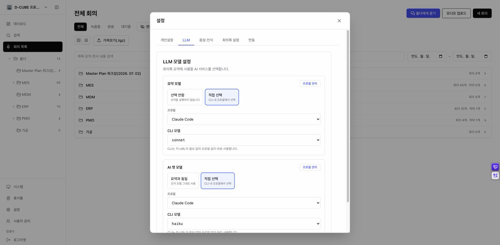

「LLM」 탭에서는 회의록 요약과 AI 챗에 쓸 AI 서비스를 정합니다. 이 탭은 **관리자 전용**입니다. 서버에 연결해 쓰는 경우 관리자 계정에만 보이고, 이 PC에서 혼자 쓰는 로컬 모드에서는 모두에게 보입니다. 일반 사용자는 [개인설정](../personal/)의 「내 LLM 설정」에서 자기 회의에 쓸 AI를 따로 정할 수 있습니다.

:::note
개인 설정이 있는 사용자는 이 탭의 서버 설정보다 자기 설정이 우선합니다. 서버 설정은 개인 설정이 없는 사용자와 개인 설정을 꺼 둔 사용자에게 적용되는 기본값입니다.
:::

## 화면 구성

탭 안에는 「LLM 모델 설정」 카드 하나가 있습니다. 설명 문구는 「회의록 요약에 사용할 AI 서비스를 선택합니다.」입니다.

1. 「요약 모델」 카드: 회의록 요약에 쓸 AI를 고릅니다.
2. 「AI 챗 모델」 카드: 회의 AI 챗에 쓸 AI를 고릅니다.
3. 「챗 모델」 입력 칸: AI 챗이 「요약과 동일」일 때만 나타납니다.
4. 「연결 테스트」와 「저장」 단추
5. 결과 메시지 줄

두 카드의 오른쪽 위에는 「프로필 관리」 단추가 있습니다.

## 모델을 고르는 방식

카드마다 먼저 큰 단추를 고르고, 그 아래의 「프로필」 목록에서 구체적인 서비스를 고릅니다.

### 요약 모델 카드

| 단추 | 설명 |
|---|---|
| 선택 안함 | 「요약을 실행하지 않습니다」 서버에서 AI 요약이 만들어지지 않습니다. |
| 직접 선택 | 「CLI·내 프로필에서 선택」 |

### AI 챗 모델 카드

| 단추 | 설명 |
|---|---|
| 요약과 동일 | 「요약 모델 그대로 사용」 |
| 직접 선택 | 「CLI·내 프로필에서 선택」 |

:::caution
요약 모델을 「선택 안함」으로 하고 AI 챗을 「요약과 동일」로 두면 AI 챗도 실행되지 않습니다. 화면에도 「요약 모델이 '선택 안함'이면 AI 챗(요약과 동일)도 실행되지 않습니다.」라고 안내됩니다.
:::

### 프로필 목록

「프로필」 목록은 세 묶음으로 나뉩니다.

| 묶음 | 내용 |
|---|---|
| 시스템 CLI | Claude Code, Antigravity CLI, Codex CLI. 서버에 설치된 명령줄 도구를 그대로 씁니다. |
| 내 프로필 | 직접 만든 프로필입니다. 「이름 — 모델명」으로 보입니다. |
| ＋ 새 프로필 만들기… | 고르면 프로필 만들기 창이 바로 열립니다. |

「시스템 CLI」를 고르면 아래에 「CLI 모델」 목록이 나타납니다. 예를 들어 Claude Code는 `sonnet`, `opus`, `haiku` 중에서 고를 수 있습니다. 「CLI는 키·URL이 필요 없어 프로필 없이 바로 사용합니다.」라고 안내됩니다.

:::note
「시스템 CLI」는 서버에서 실행됩니다. 해당 CLI가 서버에 설치되어 로그인되어 있어야 하며, 이 목록은 관리자와 로컬 모드 사용자에게만 서버 설정 화면에 노출됩니다.
:::

## 요약·챗 모델 설정하는 순서

1. 설정 창에서 「LLM」 탭을 엽니다.
2. 「요약 모델」 카드에서 「직접 선택」을 누르고 「프로필」 목록에서 서비스를 고릅니다.
3. 「AI 챗 모델」 카드를 같은 방식으로 정하거나, 요약과 같이 쓰려면 「요약과 동일」을 그대로 둡니다.
4. 「요약과 동일」일 때 챗에만 다른 모델명을 쓰고 싶으면 「챗 모델」 칸에 적습니다. 칸 안내는 「모델명을 입력하세요 (비우면 요약 모델)」입니다.
5. 「연결 테스트」를 눌러 응답을 확인합니다. 성공하면 「연결 성공」, 실패하면 「연결 실패: 이유」가 나타납니다.
6. 「저장」을 누릅니다. 「AI 설정이 저장되었습니다.」가 나타나면 끝입니다.

「연결 테스트」는 요약 모델 기준으로 동작하며, 요약 모델이 「선택 안함」이면 누를 수 없습니다. 저장에 실패하면 「AI 설정 저장에 실패했습니다.」, 설정을 읽지 못하면 「설정을 불러오지 못했습니다.」가 나타납니다. 서버와 연결할 수 없을 때는 「Sidecar 연결 불가 — 오프라인 상태」가 노란 글씨로 나옵니다.

## LLM 프로필 관리

프로필은 AI 서비스 접속 정보(주소, 키, 모델명, 토큰 한도)를 한 묶음으로 저장해 둔 것입니다. 한 번 만들어 두면 요약과 챗 어디서든 이름으로 골라 쓸 수 있습니다. 이 탭에서 만든 프로필은 서버 전체에서 쓰는 프로필이고, 개인설정의 「내 LLM 설정」에서 만든 프로필은 내 것으로만 쓰입니다.

「프로필 관리」 단추를 누르면 「LLM 프로필 관리」 창이 열립니다.

1. 프로필 목록: 프로필마다 이름, 서비스 이름표, 모델명, 가려진 키(앞뒤 일부만 보임)가 나옵니다.
2. 각 줄의 「편집」과 「삭제」 단추
3. 「＋ 새 프로필」 단추

「삭제」를 누르면 「'이름' 프로필을 삭제할까요? 이 프로필을 쓰는 설정은 해제됩니다.」라고 확인합니다. 지금 쓰고 있는 프로필을 지우면 선택은 자동으로 다른 항목으로 바뀌므로, 지운 뒤에는 모델 선택을 다시 확인하고 저장하세요.

### 프로필 만들기

「＋ 새 프로필」(또는 목록의 「＋ 새 프로필 만들기…」)을 누르면 입력 양식이 열립니다.

1. 위쪽 서비스 카드 중에서 하나를 고릅니다.
2. 「API Base URL」을 확인합니다. 서비스를 고르면 알맞은 주소가 자동으로 채워집니다.
3. 키가 필요한 서비스라면 「API Key」를 입력합니다.
4. 「모델명」을 고르거나 입력합니다.
5. 필요하면 「최대 입력 토큰」, 「최대 출력 토큰」을 조정합니다.
6. 「프로필 이름」을 적습니다. 비워 두면 「서비스 · 모델명」으로 자동으로 정해집니다.
7. 「연결 테스트」로 확인한 뒤 「프로필 저장」을 누릅니다. 중간에 그만두려면 「취소」를 누릅니다.

서비스 카드는 다음과 같습니다.

| 서비스 | 카드 설명 | 키 |
|---|---|---|
| Anthropic | Claude API (키 필요) | 필요 |
| Z.AI | GLM 모델 (Anthropic 호환) | 필요 |
| Google Gemini | Gemini API (키 필요, OpenAI 호환) | 필요 |
| OpenAI | GPT 모델 (키 필요) | 필요 |
| Ollama | 로컬 실행 (키 불필요) | 불필요 |
| LM Studio | 로컬 실행 (키 불필요) | 불필요 |
| 직접 입력 | 호환 API 직접 설정 | 필요 |

양식의 항목은 다음과 같습니다.

| 항목 | 설명 |
|---|---|
| API Base URL | 서비스 주소입니다. 서비스를 고르면 기본 주소가 채워집니다. 비워 둘 수 있는 서비스도 있습니다. |
| API Key | 키가 필요한 서비스에만 보입니다. 입력 칸 옆의 「API 키 발급 ↗」를 누르면 해당 서비스의 키 발급 페이지가 열립니다. |
| 모델명 | 목록에서 고르거나 「직접 입력」을 눌러 직접 적을 수 있습니다. 다시 목록으로 돌아가려면 「목록에서 선택」을 누릅니다. |
| 모델 새로고침 | 로컬 서비스와 클라우드 서비스에서 보이는 단추입니다. 모델 목록을 다시 불러옵니다. |
| 최대 입력 토큰 | 한 번에 AI에 보낼 수 있는 입력의 상한입니다. 기본값은 200000입니다. |
| 최대 출력 토큰 | AI가 한 번에 답할 수 있는 길이의 상한입니다. 기본값은 10000입니다. |
| 프로필 이름 | 목록에 보일 이름입니다. |

:::tip
이미 저장한 프로필을 「편집」할 때 API Key 칸을 비워 두면 기존 키가 그대로 유지됩니다. 화면에도 「현재: … — 비워두면 기존 키 유지」로 안내됩니다. 키를 바꿀 때만 새로 입력하세요.
:::

클라우드 서비스(Anthropic, Z.AI, OpenAI, 직접 입력)는 키가 있어야 모델을 조회할 수 있으므로, 「모델 새로고침」을 눌러야 목록을 불러옵니다. 실패하면 「모델 목록을 불러올 수 없습니다. API 키·Base URL을 확인하세요.」가 나타나고, 미리 넣어 둔 추천 모델 목록이 대신 쓰입니다.

## 로컬 LLM (Ollama, LM Studio) 연결

내 컴퓨터에서 직접 돌리는 AI를 쓰고 싶다면 Ollama나 LM Studio를 프로필로 연결할 수 있습니다. 키가 필요 없고 회의 내용이 외부 서비스로 나가지 않는다는 장점이 있습니다.

### 연결 순서

1. 먼저 Ollama 또는 LM Studio를 설치하고 서버를 실행해 둡니다. LM Studio는 모델을 하나 내려받아 로컬 서버를 켜야 합니다.
2. 「프로필 관리」 → 「＋ 새 프로필」에서 「Ollama」 또는 「LM Studio」 카드를 고릅니다.
3. 「API Base URL」에 기본 주소가 채워집니다. Ollama는 `http://localhost:11434/v1`, LM Studio는 `http://localhost:1234/v1`입니다. 다른 포트나 다른 컴퓨터에서 돌리고 있으면 주소를 고칩니다.
4. 서비스를 고르면 설치된 모델 목록을 자동으로 찾아 「모델명」 목록에 채웁니다. 찾는 동안 단추는 「감지 중...」으로 바뀝니다. 주소를 고친 뒤에는 「모델 새로고침」을 눌러 다시 찾습니다.
5. 모델을 고르고 「연결 테스트」, 「프로필 저장」을 누릅니다.
6. 「요약 모델」 또는 「AI 챗 모델」의 「프로필」 목록에서 방금 만든 프로필을 고르고 「저장」합니다.

### 모델 목록이 비어 있을 때

「로컬 서버에 연결할 수 없습니다. 실행 중인지 확인하세요.」가 나타나면 모델 목록을 가져오지 못한 것입니다. 다음 순서로 확인하세요.

1. Ollama 또는 LM Studio가 실행 중인지 확인합니다.
2. 주소와 포트가 맞는지 확인합니다.
3. **LM Studio라면 CORS(교차 출처 허용)를 켭니다.** 모델 목록은 브라우저가 직접 로컬 서버에 물어서 가져오는데, LM Studio는 기본값에서 이 요청을 막습니다. LM Studio의 서버 설정에서 CORS를 켜거나, 명령줄에서 `lms server start --cors`로 서버를 시작합니다.
4. Ollama는 같은 컴퓨터(localhost)에서 접속하면 기본으로 허용됩니다. 다른 주소의 웹 화면에서 Ollama 모델 목록을 가져와야 한다면 Ollama 쪽에서 해당 출처를 허용하도록 설정해야 합니다.
5. 그래도 안 되면 목록 가져오기는 포기하고 「모델명」 옆의 「직접 입력」으로 모델명을 직접 적어도 됩니다.

:::caution
모델 **목록**은 지금 보고 있는 브라우저(또는 앱)에서 가져오지만, 실제 요약과 AI 챗은 **서버**가 로컬 LLM에 요청해서 처리합니다. 서버에 접속해 쓰는 환경에서 `localhost`는 내 PC가 아니라 서버 자신을 뜻합니다. 따라서 Ollama나 LM Studio는 요약을 처리하는 서버에서 접근할 수 있는 곳에서 실행되어야 합니다. 내 PC에서 돌리는 로컬 LLM을 서버가 쓰게 하려면, 서버가 접근할 수 있는 주소를 「API Base URL」에 적어야 합니다. 이 PC 하나로 모두 처리하는 로컬 모드에서는 이런 걱정이 없습니다.
:::

:::tip
로컬 모델은 회의가 길수록 처리 시간이 오래 걸립니다. 요약이 도중에 끊기거나 품질이 떨어지면 「최대 입력 토큰」과 「최대 출력 토큰」을 사용하는 모델의 한도에 맞게 줄여 보세요.
:::

## 자주 겪는 문제

| 증상 | 확인할 것 |
|---|---|
| 「연결 실패: …」 | 주소, 키, 모델명이 맞는지 확인합니다. 키는 비워 두면 기존 키를 유지하므로, 새 키를 붙여 넣었는지 확인합니다. |
| 요약이 만들어지지 않음 | 요약 모델이 「선택 안함」인지, 개인설정에 다른 설정이 있는지 확인합니다. |
| 시스템 CLI를 고르면 요약이 실패함 | 서버에 해당 CLI가 설치되어 있고 로그인되어 있는지 확인합니다. |
| 로컬 LLM 모델 목록이 비어 있음 | 위의 「모델 목록이 비어 있을 때」를 따라 확인합니다. |

요약이 어떻게 만들어지고 다시 만드는지는 [AI 회의록](../../minutes/ai-summary/)을 보세요.
