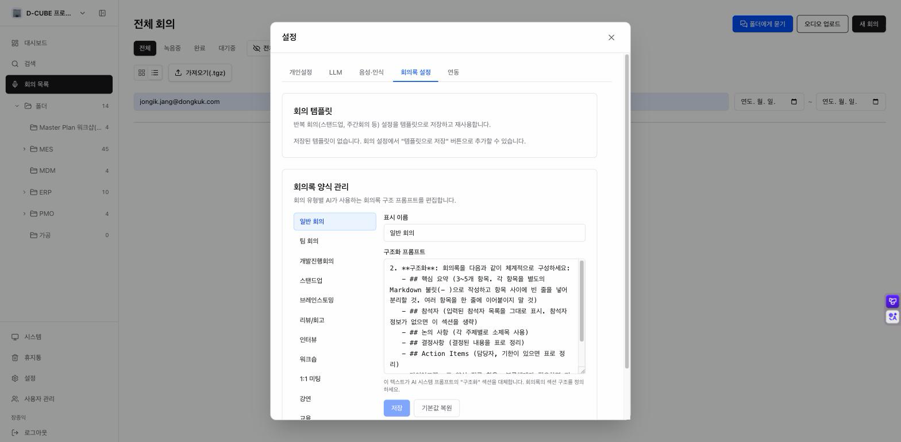

「회의록 설정」 탭에서는 회의를 만들고 회의록을 내보낼 때 쓰는 틀을 관리합니다. 이 탭은 **관리자 전용**입니다. 서버에 연결해 쓰는 경우 관리자 계정에만 보이고, 이 PC에서 혼자 쓰는 로컬 모드에서는 모두에게 보입니다. 탭 안에서도 일부 카드는 환경에 따라 보이지 않습니다.

## 화면 구성

위에서 아래로 다음 카드가 놓입니다.

1. 「앱 자동시작」: 로컬 모드의 데스크톱 앱에서만 보입니다.
2. 「회의 템플릿」
3. 「화이트보드 내보내기 · 웹」: 관리자와 로컬 모드에서 보입니다.
4. 「회의록 양식 관리」

## 앱 자동시작

로컬 모드로 쓰는 데스크톱 앱에서만 보이는 카드입니다. 설명 문구는 「로그인 시 또박또박을 자동으로 시작합니다.」입니다.

- 「로그인 시 자동 시작」 스위치: 「예약 회의를 백그라운드에서 자동 시작하려면 켜세요 (기본 꺼짐)」

켜 두면 PC에 로그인할 때 또박또박이 함께 시작되어, 예약해 둔 회의를 앱을 직접 켜지 않아도 시작할 수 있습니다. 예약 회의와 백그라운드 동작은 [회의 예약](../../schedule/schedule/)과 [트레이와 백그라운드 실행](../../schedule/background/)에서 설명합니다.

## 회의 템플릿

설명 문구는 「반복 회의(스탠드업, 주간회의 등) 설정을 템플릿으로 저장하고 재사용합니다.」입니다. 템플릿은 이 탭이 아니라 녹음 화면 위쪽 도구 줄의 「템플릿으로 저장」 단추로 만듭니다. 템플릿을 고르는 것은 모든 사용자가 할 수 있지만, 만들고 고치고 지우는 일은 관리자(로컬 모드에서는 모든 사용자)만 합니다. 여기서는 만들어 둔 템플릿의 목록을 정리합니다.

저장된 템플릿이 없으면 「저장된 템플릿이 없습니다. 회의 설정에서 "템플릿으로 저장" 버튼으로 추가할 수 있습니다.」가 나타납니다.

템플릿이 있으면 한 줄에 하나씩 나열되고, 줄마다 다음이 보입니다.

1. 템플릿 이름
2. 회의 유형 이름표: 템플릿에 회의 유형이 지정되어 있을 때만 보입니다.
3. 연필 단추: 이름을 고칩니다.
4. 휴지통 단추: 템플릿을 삭제합니다.

### 템플릿 이름 고치기

1. 고칠 템플릿 줄의 연필 단추를 누릅니다. 이름이 입력 칸으로 바뀝니다.
2. 새 이름을 입력합니다.
3. 체크 단추를 누르거나 Enter 키를 눌러 확정합니다. 취소하려면 X 단추나 Esc 키를 누릅니다. 이름이 비어 있으면 확정되지 않습니다.

휴지통 단추를 누르면 곧바로 삭제됩니다. 삭제 전에 묻는 창은 없으니 주의하세요. 템플릿을 새로 만들고 쓰는 방법은 [새 회의 만들기](../../meetings/new-meeting/)를 보세요.

## 화이트보드 내보내기 · 웹

회의록을 화이트보드 형태의 HTML 파일(.html)로 내보내는 기능에서, **웹으로 접속한 사용자**가 쓰는 생성 방식을 정하는 카드입니다. 관리자와 로컬 모드에서만 보입니다.

카드 설명은 다음과 같습니다. 「기본은 서버의 Claude Code로 만듭니다(모든 웹 사용자가 서버 PC의 Claude 계정 하나를 나눠 씁니다). 끄면 사용자가 지시문 파일을 받아 자기 Claude에 붙여 넣습니다. 데스크톱 앱은 이 설정과 상관없이 그 PC의 Claude Code를 씁니다.」

| 선택지 | 설명 |
|---|---|
| 서버의 Claude Code (기본) | 서버에 설치된 Claude Code가 화이트보드를 만듭니다. 오른쪽 이름표가 「확인됨」이면 서버에서 쓸 수 있는 상태이고, 「찾을 수 없음」이면 서버에 설치되어 있지 않은 것입니다. 찾을 수 없을 때는 이 선택지를 고를 수 없습니다. |
| 끄기 · 지시문 파일로 내려받기 | 서버에서는 만들지 않습니다. 웹 사용자가 지시문 파일을 내려받아 자기 Claude에 붙여 넣어 만듭니다. |

라디오 단추를 누르는 즉시 저장됩니다. 저장에 실패하면 「설정을 저장하지 못했습니다. 다시 시도해 주세요.」, 읽지 못하면 「화이트보드 설정을 불러오지 못했습니다.」가 나타납니다.

:::caution
「서버의 Claude Code」를 쓰면 모든 웹 사용자가 서버의 Claude 계정 하나를 나눠 씁니다. 사용량이나 계정 정책이 걱정되면 「끄기 · 지시문 파일로 내려받기」를 고르세요. 웹 화면에서 회의록 화이트보드가 실패할 때는 서버의 Claude 로그인이 풀렸는지 먼저 확인하세요.
:::

화이트보드를 포함한 내보내기 전체는 [내보내기](../../share/export/)를 보세요.

## 회의록 양식 관리

회의 유형마다 AI가 회의록을 어떤 구조로 쓸지 정하는 카드입니다. 설명 문구는 「회의 유형별 AI가 사용하는 회의록 구조 프롬프트를 편집합니다.」입니다. 회의 유형은 새 회의를 만들 때 고릅니다.

### 화면 구성

카드는 왼쪽 목록과 오른쪽 편집 영역으로 나뉩니다.

1. 왼쪽 유형 목록: 회의 유형이 나열됩니다. 직접 추가한 유형에는 「커스텀」 표시가 붙습니다. 처음에 기본으로 들어 있는 유형은 「일반 회의」, 「팀 회의」, 「개발진행회의」, 「스탠드업」 등입니다.
2. 목록 맨 아래의 「+ 새 유형 추가」
3. 오른쪽 편집 영역: 고른 유형의 「표시 이름」과 「구조화 프롬프트」
4. 「저장」, 「기본값 복원」 또는 「삭제」 단추

아무것도 고르지 않았을 때는 「왼쪽에서 유형을 선택하세요.」가 나타납니다.

### 기존 유형의 양식 고치기

1. 왼쪽 목록에서 유형을 고릅니다.
2. 「표시 이름」을 바꾸거나, 「구조화 프롬프트」에서 회의록의 섹션 구조를 고칩니다. 이 글은 AI에게 주는 지시문으로, 「이 텍스트가 AI 시스템 프롬프트의 "구조화" 섹션을 대체합니다. 회의록의 섹션 구조를 정의하세요.」라고 안내됩니다.
3. 「저장」을 누릅니다. 변경한 것이 있을 때만 단추가 눌립니다. 「저장되었습니다.」가 나타납니다.

기본으로 들어 있는 유형에는 「기본값 복원」 단추가 있습니다. 누르면 「이 유형의 프롬프트를 기본값으로 복원하시겠습니까?」라고 확인한 뒤 처음 상태로 되돌리고 「기본값으로 복원되었습니다.」가 나타납니다. 내가 추가한 유형에는 이 단추 대신 「삭제」가 있습니다. 누르면 「"…" 유형을 삭제하시겠습니까?」라고 확인합니다.

### 새 유형 추가하기

1. 왼쪽 목록 아래의 「+ 새 유형 추가」를 누릅니다. 오른쪽에 「새 회의 유형 추가」 양식이 열립니다.
2. 「유형 코드」를 입력합니다. 영문 소문자, 숫자, 밑줄만 쓸 수 있습니다(예: `daily_sync`). 다른 문자는 입력하는 즉시 지워집니다.
3. 「표시 이름」을 입력합니다(예: 데일리 싱크). 회의를 만들 때 목록에 보이는 이름입니다.
4. 「구조화 프롬프트」에 회의록의 섹션 구조를 적습니다. 입력 칸 안의 예시처럼 `## 섹션1 (…)`, `## 섹션2 (…)` 형태로 섹션 이름과 쓸 내용을 나열하면 됩니다.
5. 「추가」를 누릅니다. 세 칸이 모두 채워져야 눌립니다. 성공하면 「새 유형이 추가되었습니다.」가 나타납니다. 그만두려면 「취소」를 누릅니다.

「추가에 실패했습니다. 유형 코드가 중복되었을 수 있습니다.」가 나타나면 이미 있는 코드이므로 다른 코드로 바꿔 다시 시도하세요.

:::tip
섹션마다 괄호 안에 "표로 정리", "담당자와 기한 포함"처럼 어떻게 쓸지 구체적으로 적으면 AI가 더 일정한 모양의 회의록을 만듭니다. 잘 맞지 않으면 기본 유형의 프롬프트를 복사해 시작점으로 삼으세요.
:::

양식을 바꾸면 이후에 회의록을 만들거나 다시 만들 때 새 양식이 쓰입니다. 이미 만들어진 회의록의 내용이 저절로 바뀌지는 않습니다. 회의록을 다시 만드는 방법은 [AI 회의록](../../minutes/ai-summary/)을 보세요.
