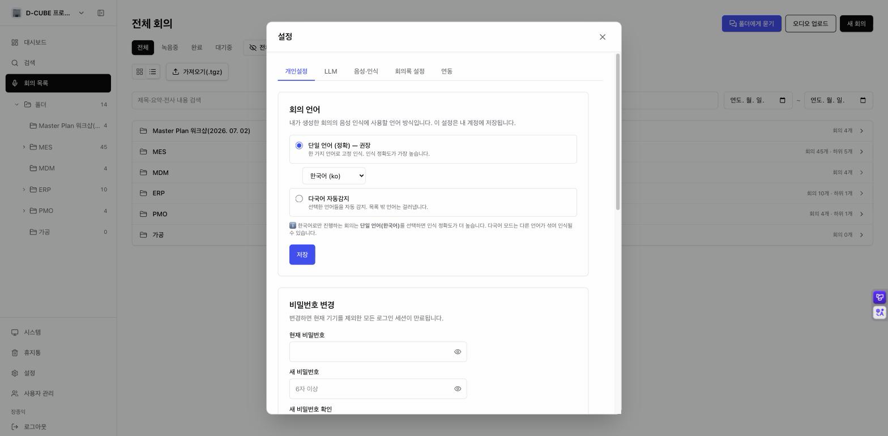
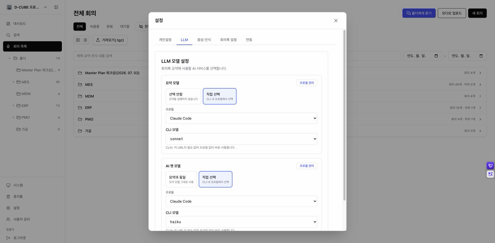

「개인설정」은 내 계정에만 적용되는 설정을 모아 둔 탭입니다. 다른 사용자에게는 영향을 주지 않습니다. 사이드바 아래쪽의 「설정」 단추를 누르면 설정 창이 열립니다.

## 설정 창과 탭

설정 창 제목은 「설정」입니다. 누가 어떤 환경에서 여느냐에 따라 보이는 모습이 다릅니다.

| 상황 | 보이는 화면 |
|---|---|
| 서버에 연결해 쓰는 일반 사용자 | 탭 줄 없이 「개인설정」 내용만 보입니다. |
| 관리자 계정, 또는 이 PC에서 혼자 쓰는 로컬 모드 | 탭 줄이 보입니다. 「개인설정」, 「LLM」, 「음성·인식」, 「회의록 설정」, 「연동」, 「STT 용어 학습」 여섯 탭입니다. |
| 오프라인(서버 없이 쓰는 Android) 화면 | 「오프라인 설정」 하나만 보입니다. 자세한 내용은 [오프라인 녹음](../../recording/offline/)을 보세요. |

:::note
이 매뉴얼에서 「관리자 전용」이라고 적힌 항목은 관리자 계정이나 로컬 모드에서만 보입니다. 일반 사용자 화면에는 나타나지 않습니다.
:::

## 개인설정 탭의 구성

위에서 아래로 다음 순서로 카드가 놓입니다. 일부는 환경에 따라 보이지 않습니다.

1. 실행 모드: 데스크톱 앱에서만 보입니다.
2. 회의 언어
3. 비밀번호 변경: 서버에 로그인해 쓰는 경우에만 보입니다.
4. 내 LLM 설정
5. API 토큰
6. 전사 위치(온디바이스): Android 앱에서만 보입니다.

## 실행 모드 (데스크톱 앱)

데스크톱 앱에서는 지금 앱이 어떤 방식으로 동작하는지 한 줄로 알려 줍니다.

- 「서버 연결 모드」: 서버에 접속해서 쓰는 중입니다. 아래에 「접속 서버: …」로 주소가 함께 보입니다.
- 「로컬 실행 모드」: 이 PC 안에서 모든 것을 처리하는 중입니다.

오른쪽의 단추는 다음과 같습니다.

| 단추 | 하는 일 |
|---|---|
| 서버 변경 | 서버 연결 모드일 때만 보입니다. 접속 서버 주소만 다시 고르고, 로컬/서버 모드 선택은 그대로 둡니다. |
| 모드 재설정 | 로컬/서버 모드 선택부터 처음부터 다시 합니다. |

두 단추를 누르면 앱이 다시 시작됩니다. 처음 모드를 고르는 화면은 [첫 실행](../../start/first-run/)에서 설명합니다.

## 회의 언어

「회의 언어」는 내가 만드는 회의의 음성 인식에 쓸 언어 방식을 정합니다. 설명 문구는 「내가 생성한 회의의 음성 인식에 사용할 언어 방식입니다. 이 설정은 내 계정에 저장됩니다.」입니다.

두 가지 방식 중에서 고릅니다.

| 방식 | 설명 |
|---|---|
| 단일 언어 (정확) — 권장 | 「한 가지 언어로 고정 인식. 인식 정확도가 가장 높습니다.」 고르면 아래에 「단일 언어 선택」 목록이 나타납니다. |
| 다국어 자동감지 | 「선택한 언어들을 자동 감지. 목록 밖 언어는 걸러냅니다.」 고르면 아래에 언어별 체크 상자가 나타납니다. |

고를 수 있는 언어는 한국어(ko), English(en), 日本語(ja), 中文(zh), Español(es), Français(fr), Deutsch(de), ไทย(th), Tiếng Việt(vi)입니다.

### 언어 방식을 바꾸는 순서

1. 「단일 언어 (정확) — 권장」 또는 「다국어 자동감지」를 고릅니다.
2. 단일 언어면 목록에서 언어를 하나 고릅니다. 다국어면 쓸 언어에 체크합니다. 체크 상자가 하나만 남으면 그 항목은 끌 수 없습니다. 언어는 최소 하나가 필요하기 때문입니다.
3. 「저장」을 누릅니다. 「저장되었습니다.」가 나타나면 끝입니다.

:::tip
한국어로만 진행하는 회의라면 「단일 언어(한국어)」를 고르세요. 화면에도 「한국어로만 진행하는 회의는 단일 언어(한국어)를 선택하면 인식 정확도가 더 높습니다. 다국어 모드는 다른 언어가 섞여 인식될 수 있습니다.」라고 안내되어 있습니다.
:::

개인 설정을 저장하기 전에는 서버의 기본값이 화면에 채워져 있습니다.

## 비밀번호 변경

서버에 로그인해서 쓰는 경우에만 보이는 카드입니다. 이 PC에서 혼자 쓰는 로컬 모드나 자동 로그인 계정에서는 비밀번호가 필요 없으므로 보이지 않습니다.

카드 설명은 「변경하면 현재 기기를 제외한 모든 로그인 세션이 만료됩니다.」입니다.

1. 「현재 비밀번호」를 입력합니다.
2. 「새 비밀번호」를 입력합니다. 입력 칸에 「6자 이상」이라고 적혀 있습니다.
3. 「새 비밀번호 확인」에 같은 비밀번호를 한 번 더 입력합니다.
4. 「비밀번호 변경」을 누릅니다.

성공하면 「비밀번호가 변경되었습니다. 다른 기기는 다시 로그인해야 합니다.」가 나타납니다. 새 비밀번호와 확인 값이 다르면 「새 비밀번호가 일치하지 않습니다.」, 서버에서 거절하면 「비밀번호 변경에 실패했습니다.」 또는 서버가 알려 주는 이유가 나타납니다.

:::caution
비밀번호를 바꾸면 지금 쓰는 기기를 뺀 나머지 기기의 로그인이 풀립니다. 휴대폰이나 다른 PC에서는 새 비밀번호로 다시 로그인해야 합니다.
:::

비밀번호를 잊었을 때의 방법은 [로그인](../../start/login/)을 보세요.

## 내 LLM 설정

「내 LLM 설정」은 내가 만든 회의의 AI 요약과 AI 챗에 쓸 AI 서비스를 내 개인 설정으로 정하는 카드입니다. 설명 문구는 「개인 LLM을 설정하면 내 회의 요약에 사용됩니다. 비활성화 시 서버 기본 LLM을 사용합니다.」입니다.

서버 전체에 적용되는 LLM 설정은 관리자가 [LLM 탭](../llm/)에서 합니다. 개인 설정이 있으면 그것이 서버 설정보다 우선합니다. 요약이 기대와 다른 AI로 만들어지면 먼저 이 카드에 개인 설정이 있는지 확인하세요.

### 화면 구성

1. 제목 오른쪽 스위치 「내 LLM 활성화」: 개인 설정이 한 번이라도 저장된 뒤부터 보입니다. 끄면 내 설정은 남겨 둔 채로 서버 기본 LLM을 씁니다.
2. 상태 배너: 지금 어떤 설정이 쓰이는지 알려 줍니다.
3. 「요약 모델」 카드
4. 「AI 챗 모델」 카드
5. 「연결 테스트」, 「저장」, 「설정 초기화」 단추

상태 배너는 세 가지 중 하나입니다.

| 배너 | 뜻 |
|---|---|
| 「내 LLM 사용 중 — 서비스 / 모델」 | 내 설정이 켜져 있습니다. 「내가 생성한 회의의 AI 요약에 이 LLM이 사용됩니다.」 |
| 「내 LLM 비활성 — 서버 기본값 (…) 사용 중」 | 설정은 저장돼 있지만 스위치가 꺼져 있습니다. 스위치를 켜면 내 LLM으로 돌아갑니다. |
| 「서버 기본값 사용 중」 | 개인 설정이 아직 없습니다. 서버에 기본 LLM이 없으면 「서버에 기본 LLM이 설정되어 있지 않습니다. 개인 LLM을 설정해야 요약 기능을 사용할 수 있습니다.」라는 경고도 함께 나옵니다. |

스위치를 끈 상태에서는 설정 입력 칸이 숨겨지고 배너만 남습니다.

### 요약 모델과 AI 챗 모델

두 카드는 같은 방식으로 고릅니다. 카드 오른쪽 위에는 「프로필 관리」 단추가 있어, 서비스 접속 정보를 저장해 둔 프로필을 만들고 고칠 수 있습니다. 프로필 만드는 방법은 [LLM 탭](../llm/)에서 자세히 설명합니다.

카드 안에서는 먼저 큰 단추 중 하나를 고릅니다.

| 카드 | 단추 | 뜻 |
|---|---|---|
| 요약 모델 | 선택 안함 | 「서버 기본 LLM 사용」 |
| 요약 모델 | 직접 선택 | 「CLI·내 프로필에서 선택」 |
| AI 챗 모델 | 요약과 동일 | 「요약 모델 그대로 사용」 |
| AI 챗 모델 | 선택 안함 | 「서버 기본 챗 모델 사용」 |
| AI 챗 모델 | 직접 선택 | 「CLI·내 프로필에서 선택」 |

그 아래의 「프로필」 목록에서 실제로 쓸 것을 고릅니다. 목록은 세 묶음입니다.

- 「시스템 CLI」: Claude Code, Antigravity CLI, Codex CLI. 키나 주소가 필요 없어 프로필 없이 바로 쓰며, 고르면 「CLI 모델」 목록이 나타납니다.
- 「내 프로필」: 내가 만든 프로필입니다. 「이름 — 모델명」으로 보입니다.
- 「＋ 새 프로필 만들기…」: 고르면 프로필 만들기 창이 바로 열립니다.

:::caution
CLI 모델은 내 PC가 아니라 서버에서 실행됩니다. 화면에도 「CLI 모델은 내 PC가 아니라 서버에서 실행됩니다. 서버에 해당 CLI가 설치되어 있어야 합니다.」라고 안내됩니다. 서버에 해당 CLI가 없으면 요약이 실패합니다.
:::

AI 챗이 「요약과 동일」일 때만 「챗 모델 (AI 챗에만 적용)」 입력 칸이 함께 나타납니다. 요약은 그대로 두고 챗에서만 다른 모델명(예: `gpt-4o`)을 쓰고 싶을 때 적습니다. 비워 두면 요약 모델을 그대로 씁니다.

### 설정 저장과 테스트

1. 요약 모델과 AI 챗 모델을 고릅니다.
2. 「연결 테스트」를 눌러 요약 모델이 실제로 응답하는지 확인합니다. 성공하면 「연결 성공 (0000ms)」처럼 응답 시간이 함께 나오고, 실패하면 「연결 실패: 이유」가 나옵니다. 요약 모델이 「선택 안함」이면 이 단추는 나타나지 않습니다.
3. 「저장」을 누릅니다. 「저장되었습니다.」가 나타납니다.

「설정 초기화」는 저장된 개인 설정이 있을 때만 보입니다. 요약과 챗 설정을 모두 지우고 서버 기본값으로 돌아갑니다.

## API 토큰

「API 토큰」 카드에서는 외부 도구나 AI 에이전트가 내 회의 데이터를 읽을 때 쓰는 개인 액세스 토큰을 발급하고 관리합니다. 카드 오른쪽 위에는 「LLM 스킬 다운로드」와 「토큰 발급」 단추가 있습니다.

발급 방법, 스코프의 뜻, 스킬 설치까지의 전체 흐름은 [회의 API](../meeting-api/) 페이지에서 단계별로 설명합니다.

## 전사 위치 (온디바이스)

Android 앱에서만 보이는 카드입니다. 서버 없이 폰 안에서 전사할지 정합니다. 선택지는 「자동」, 「서버」, 「온디바이스」와 체크 상자 「로컬 회의 서버로 전송」입니다. 모델 내려받기를 포함한 자세한 내용은 [오프라인 녹음](../../recording/offline/)에서 설명합니다.
