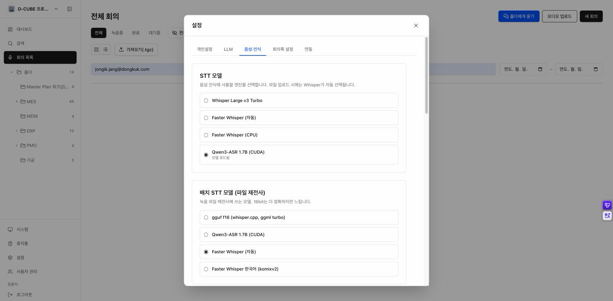

「음성·인식」 탭은 말소리를 글로 바꾸는 방법을 정합니다. 이 탭은 **관리자 전용**입니다. 서버에 연결해 쓰는 경우 관리자 계정에만 보이고, 이 PC에서 혼자 쓰는 로컬 모드에서는 모두에게 보입니다. 여기서 바꾼 값은 서버 전체에 적용됩니다.

:::note
내가 만드는 회의의 인식 언어(한국어, 영어 등)는 이 탭이 아니라 [개인설정](../personal/)의 「회의 언어」에서 정합니다.
:::

## 화면 구성

위에서 아래로 다섯 개의 카드가 놓입니다.

1. 「STT 모델」: 실시간 전사에 쓸 음성 인식 엔진
2. 「배치 STT 모델 (파일 재전사)」: 녹음 파일을 다시 전사할 때 쓸 모델
3. 「HuggingFace」: 화자 분리 모델을 내려받는 데 필요한 토큰
4. 「화자 분리 설정」: 화자 분리 사용 여부와 민감도
5. 「음성 청킹 설정」: 목소리를 끊어 인식하는 방식을 세밀하게 조정

## STT 모델

설명 문구는 「음성 인식에 사용할 엔진을 선택합니다. 파일 업로드 시에는 Whisper가 자동 선택됩니다.」입니다. 서버에서 쓸 수 있는 엔진이 라디오 단추 목록으로 나타납니다.

| 이름 | 설명 |
|---|---|
| Whisper Large v3 Turbo | Whisper 계열 모델입니다. |
| Qwen3-ASR 1.7B (8bit 양자화) | Qwen3-ASR 모델의 8bit 버전입니다. |
| Qwen3-ASR 1.7B (6bit 양자화) | Qwen3-ASR 모델의 6bit 버전입니다. |
| Qwen3-ASR 1.7B (CUDA) | Qwen3-ASR 모델의 CUDA 버전입니다. 서버 환경에 맞는 경우에만 쓸 수 있습니다. |
| Qwen3-ASR 1.7B (vLLM 고속) | Qwen3-ASR 모델의 vLLM 버전입니다. 서버 환경에 맞는 경우에만 쓸 수 있습니다. |
| Faster Whisper (자동) | Faster Whisper 엔진의 자동 선택 항목입니다. |
| Faster Whisper (CPU) | Faster Whisper 엔진의 CPU 항목입니다. |
| Faster Whisper 한국어 (komixv2) | Faster Whisper 엔진의 한국어용 항목입니다. |

위 이름은 화면에 표시되는 라벨이며, 각 엔진의 속도나 정확도 차이는 서버 환경에 따라 달라질 수 있어 이 매뉴얼에서는 단정하지 않습니다. 서버 관리자와 상의해 고르세요.

실제로 목록에 보이는 항목은 서버 환경에 따라 다릅니다. 서버가 지원하지 않는 엔진은 나타나지 않습니다.

### 엔진을 바꾸는 순서

1. 쓰려는 엔진의 라디오 단추를 누릅니다. 별도의 저장 단추는 없고, 누르는 즉시 적용됩니다.
2. 변경하는 동안 「모델 변경 중... (모델에 따라 시간이 걸릴 수 있습니다)」가 나타납니다. 모델을 새로 올리는 시간이 필요합니다.
3. 끝나면 「STT 모델이 "…"으로 변경되었습니다.」가 나타납니다. 선택된 항목 아래에는 「모델 로드됨」 또는 「모델 로드 중...」이 표시됩니다.

「모델 로드 중...」이 사라지기 전에는 새 회의 녹음을 시작하지 않는 편이 안전합니다. 변경이 실패하면 서버가 알려 주는 이유나 「STT 모델 변경에 실패했습니다.」가 나타납니다.

:::caution
엔진을 바꾸면 모델을 새로 올리는 동안 전사가 잠시 느려지거나 멈출 수 있습니다. 엔진 변경은 진행 중인 회의가 없을 때 하세요.
:::

## 배치 STT 모델 (파일 재전사)

설명 문구는 「녹음 파일 재전사에 쓰는 모델. 16bit는 더 정확하지만 느립니다.」입니다. 오디오 파일을 올려 전사하거나, 회의 화면에서 STT를 다시 만들 때 쓰는 모델입니다. 서버 환경에 따라 다음 같은 항목이 보입니다.

| 이름 | 특징 |
|---|---|
| 8bit (빠름) | 빠르게 처리합니다. |
| 16bit (정확, 느림) | 더 정확하지만 느립니다. |
| Beam 16bit (환각 적음, 정확) | 없는 말을 지어내는 현상이 적고 정확합니다. |
| Beam 8bit (환각 적음, 빠름) | 지어내는 현상이 적고 빠릅니다. |
| gguf f16 (whisper.cpp, ggml turbo) | whisper.cpp 방식 모델입니다. |

이 밖에 STT 모델 카드와 같은 이름의 엔진이 함께 보일 수 있습니다. 고르는 즉시 적용되고 「배치 STT 모델이 "…"으로 변경되었습니다.」가 나타납니다.

파일 업로드와 전사 다시 만들기는 [오디오 파일 업로드](../../recording/upload/)와 [전사 편집](../../minutes/transcript/)을 보세요.

## HuggingFace

설명 문구는 「화자 분리(pyannote) 모델 다운로드에 필요한 토큰입니다.」입니다. 화자 분리에 쓰는 모델을 내려받으려면 HuggingFace 사이트의 접근 토큰이 필요합니다.

1. HuggingFace 계정에서 읽기 권한의 접근 토큰을 만들어 둡니다.
2. 「HF Token」 칸에 토큰을 붙여 넣습니다. 입력 칸 안내는 `hf_...`입니다.
3. 「저장」을 누릅니다. 「HuggingFace 토큰이 저장되었습니다.」가 나타납니다.

이미 저장된 토큰이 있으면 「현재: …」 아래에 가려진 값이 보입니다. 토큰이 없으면 「토큰 미설정 — 화자 분리 기능이 비활성화됩니다.」라는 노란 경고가 나옵니다. 칸이 비어 있는 동안에는 「저장」을 누를 수 없습니다.

:::caution
토큰은 비밀번호와 같습니다. 다른 사람과 공유하지 마세요. 저장한 뒤에는 화면에 일부만 가려진 채 보입니다.
:::

## 화자 분리 설정

회의에서 누가 말했는지 구분하는 기능을 정합니다.

- 「화자 분리 사용」 스위치: 「파일 업로드·STT 재생성 시 화자를 구분해 라벨을 붙입니다.」 끄면 「화자 분리가 비활성화되어 있습니다. 모든 발화가 하나의 화자로 기록됩니다.」라는 경고가 나오고, 아래 조정 항목이 흐려져 쓸 수 없게 됩니다.
- 「화자 구분 민감도」 슬라이더: 0.2에서 0.8 사이이고 기본값은 0.3입니다. 「낮을수록 화자를 더 많이 나눕니다. 여러 명이 한 화자로 뭉치면 값을 낮추세요.」 파일 업로드, STT 재생성, 「화자분리만 재실행」 때 적용됩니다.

카드 아래의 안내 상자에는 「배치 분석」이 설명되어 있습니다. 파일 업로드와 STT 재생성 때 전체 오디오를 한 번에 분석해 화자를 구분하며, 실시간 전사 중에는 화자 라벨이 붙지 않습니다. 녹음한 회의는 끝난 뒤 STT 재생성으로 화자 분리를 적용할 수 있습니다. 회의 정보의 「참여 인원」을 입력하면 그 인원수에서 앞뒤 2명 범위로 화자를 맞춥니다.

:::tip
화자 분리를 쓰려면 먼저 위의 「HuggingFace」 토큰이 저장되어 있어야 합니다. 분리 결과가 마음에 들지 않을 때 이름을 바꾸거나 다시 실행하는 방법은 [화자 분리](../../minutes/speakers/)를 보세요.
:::

## 음성 청킹 설정

설명 문구는 「음성 감지 및 청크 분할을 세밀하게 조정합니다. 변경사항은 다음 녹음부터 적용됩니다.」입니다. 청크는 말소리를 인식하기 위해 잘라 보내는 한 덩어리를 뜻합니다. 기본값이 대부분의 환경에 맞으므로 인식이 눈에 띄게 나쁠 때만 조정하세요.

각 항목은 슬라이더입니다. 값이 기본값에서 바뀌면 숫자가 파란색 굵은 글씨로 표시됩니다.

| 항목 | 기본값 | 설명 |
|---|---|---|
| 음성 감지 민감도 | 0.05 | 낮을수록 작은 소리도 음성으로 인식합니다. 주변 소음이 많으면 높이세요. |
| 음성 복귀 기준 | 0.06 | 무음으로 판정한 뒤 다시 음성으로 돌아오는 기준입니다. 음성 감지 민감도보다 높아야 합니다. |
| 무음 지속 시간 | 500ms | 이만큼 무음이 이어지면 하나의 청크로 보냅니다. 짧으면 빠른 응답, 길면 자연스러운 문장 단위가 됩니다. |
| 최대 청크 길이 | 8초 | 계속 말할 때 강제로 끊는 최대 시간입니다. 너무 길면 처리가 느려질 수 있습니다. |
| 최소 청크 길이 | 2초 | 이보다 짧은 음성은 무시합니다. 짧은 소음이나 기침을 걸러 냅니다. |
| 프리롤 | 500ms | 음성이 시작되기 전의 여유 시간을 함께 담아 첫 음절이 잘리는 것을 막습니다. |
| 청크 간 겹침 | 500ms | 앞 청크의 끝부분을 다음 청크에 포함해 경계에서 음절이 잘리는 것을 막습니다. |
| 파일 STT 청크 분할 | 30초 | 파일 업로드와 STT 재생성 때 오디오를 이 길이로 나눠 처리합니다. 0이면 나누지 않습니다. 다국어 회의는 10~15초로 짧게 하면 언어 감지가 정확해집니다. |

위 기본값은 이 매뉴얼을 쓴 시점의 서버 기본 설정입니다. 서버 관리자가 기본값을 바꿨다면 다를 수 있으며, 어느 값이 기본인지는 슬라이더 값이 파란색이 아닌 상태로 알 수 있습니다.

슬라이더를 움직이면 잠시 뒤 서버에 자동으로 저장됩니다. 별도의 저장 단추는 없습니다. 하나라도 기본값에서 바꾸면 카드 제목 오른쪽에 「기본값으로 초기화」가 나타나며, 누르면 모든 슬라이더가 기본값으로 돌아갑니다.

:::tip
인식이 이렇게 보인다면 이렇게 조정해 보세요.

- 작게 말한 부분이 빠진다: 「음성 감지 민감도」를 낮춥니다.
- 에어컨, 키보드 소리가 글로 나온다: 「음성 감지 민감도」를 높이거나 「최소 청크 길이」를 늘립니다.
- 문장의 첫 글자가 잘린다: 「프리롤」을 늘립니다.
- 문장 중간이 끊긴다: 「무음 지속 시간」을 늘립니다.
:::

## 이 탭이 보이지 않을 때

일반 사용자는 이 탭을 볼 수 없습니다. 인식 결과가 마음에 들지 않으면 관리자에게 모델이나 청킹 설정을 조정해 달라고 요청하세요. 자기 회의의 인식 언어는 누구나 [개인설정](../personal/)에서 바꿀 수 있습니다.
